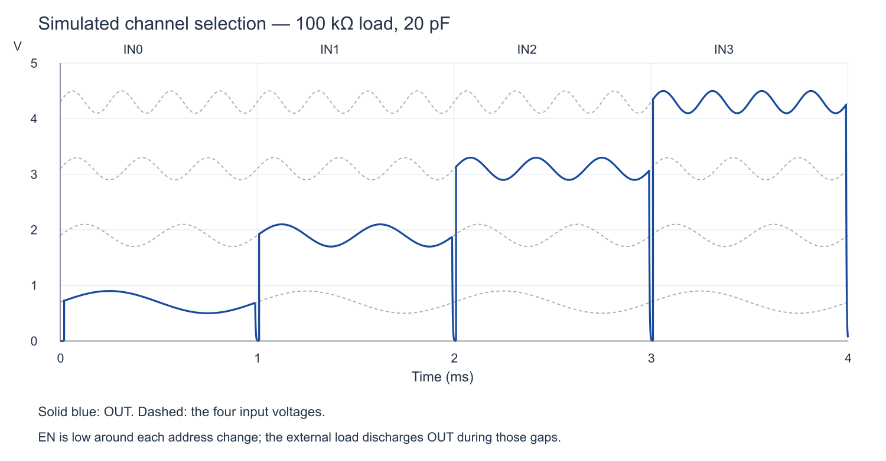

# Chipalooza-MUX

A four-input CMOS analog multiplexer project. The current reference circuit is a runnable **5 V LTspice prototype** with a transistor-level decoder and complementary transmission gates.

## Run the LTspice reference

1. [Clone this repository](https://github.com/AlexZGray/Chipalooza-MUX) or download and extract it using **Code → Download ZIP**. Keep the complete folder structure.
2. Install [LTspice](https://www.analog.com/ltspice). The examples have been verified with LTspice 26.1.1.
3. Open [`simulations/ltspice/Mux4_Complete.asc`](simulations/ltspice/Mux4_Complete.asc) and run the simulation.

The local symbols, lower-level schematics, generic transistor models, input stimulus files and waveform settings are included. No additional model library or global symbol installation is needed.

[LTspice setup, hierarchy, reuse and verification instructions →](simulations/ltspice/README.md)

## Circuit

- Four analog inputs, one common output, two address bits and an active-high enable.
- Four NMOS/PMOS transmission gates and a CMOS 2-to-4 decoder: 44 MOSFETs in total.
- A 5 V supply and 0–5 V analog/control signals for this reference example.
- Runnable complete-assembly, reusable-symbol and heavy-load examples.

With enable high, address `00`, `01`, `10` or `11` connects IN0, IN1, IN2 or IN3 respectively to OUT. With enable low, all channels are disconnected. The test inputs briefly disable the mux around address changes.

## Scope

This is a functional reference using illustrative Level-1 MOS models. It is **not a Sky130 implementation or a characterized silicon design**; its results do not establish PDK performance, bandwidth, distortion, leakage, timing or fabrication readiness. The model assumptions and switching requirements are documented with the [simulation](simulations/ltspice/README.md#model-assumptions-and-limits).

Generated simulation data is kept out of Git. Reproduce it by running the supplied schematics; small reference results and plots are included for comparison.
