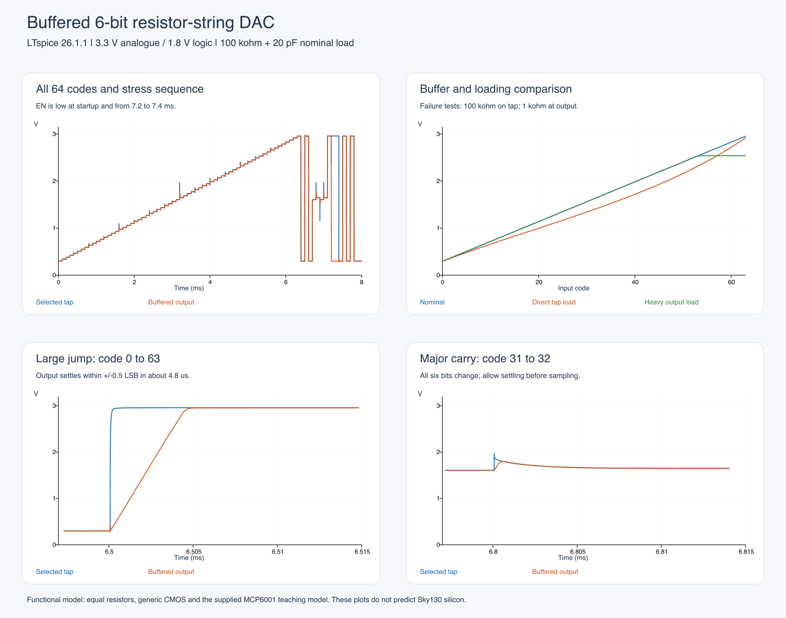

# Chipalooza

Circuit design and simulation work for **Chipalooza Challenge #4 (Sky130)**. The current project is a **buffered 6-bit resistor-string DAC** for programmable thresholds, calibration voltages and low-frequency analogue set points.

## Initial proposal

**[Proposal documents and editable versions →](docs/proposal/README.md)**

The package includes the six-page technical proposal, a separate provisional equipment list, a requirements review and submission checklist. Team details remain placeholders. The proposal has not been submitted; its Sky130 targets and planned test/bias interfaces are distinct from the current LTspice demonstrator.

## Run the LTspice DAC

1. Clone this repository, or choose **Code → Download ZIP** and extract the complete archive.
2. Install [LTspice](https://www.analog.com/ltspice). The examples were verified in **LTspice 26.1.1**.
3. Open **[simulations/ltspice/dac6/DAC6_Top.asc](simulations/ltspice/dac6/DAC6_Top.asc)** and choose **Run**.
4. Right-click a block to open its child schematic. The matching `.plt` file supplies the waveform layout; add `V(tap)`, `V(dac_in)` and `V(out)` manually if needed.

Keep all files in the `dac6` folder together. The local symbols, child schematics, model files and digital stimulus are included. **No global symbol installation, additional model download or Python package is required to run the circuit.**

**[Detailed setup, stage-by-stage explanation and test results →](simulations/ltspice/dac6/README.md)**

## Included examples

| Top-level schematic | Purpose |
|---|---|
| [DAC6_Top.asc](simulations/ltspice/dac6/DAC6_Top.asc) | Normal operation, all 64 codes, large jumps, major-carry transitions and enable/reset |
| [DAC6_Heavy_Load.asc](simulations/ltspice/dac6/DAC6_Heavy_Load.asc) | Deliberate 1 kΩ overload showing buffer clipping |
| [DAC6_Tap_Load.asc](simulations/ltspice/dac6/DAC6_Tap_Load.asc) | Deliberate loading before the buffer showing resistor-string voltage error |

The nominal design uses **3.3 V analogue power, 1.8 V digital controls, 0.3–3.0 V references, and a 100 kΩ / 20 pF load**. Its ideal resolution is **42.1875 mV per step**.



## Reproduce the numerical checks

Run all three top-level schematics in LTspice, then run this command from the repository root with Python 3.9 or later:

```sh
python3 simulations/ltspice/dac6/verify_results.py
```

On Windows, use `py -3` instead of `python3` if needed. The checker uses only Python's standard library and finds the results relative to its own folder. It verifies selection, monotonicity, accuracy, level shifting, settling, enable/reset, ladder current and the two deliberate failure cases. It writes ignored `results/latest*` files; the small [reference measurements](simulations/ltspice/dac6/results/reference.json) remain unchanged. An optional [plot script](simulations/ltspice/dac6/plot_results.py) and [plot dependencies](simulations/ltspice/dac6/requirements-plot.txt) are also included.

## Current scope

This is a **functional LTspice demonstrator**, with generic Level-1 CMOS and a supplied MCP6001 teaching macromodel. It is **not a completed Sky130 implementation or competition sign-off**. The buffer's modeled offset explains approximately 4.5 mV of settled output error; the perfect resistor matching does not predict silicon linearity.

The next design work is the Sky130 transistor amplifier, foundry resistor and switch implementation, mismatch and PVT analysis, layout, extraction, and verification with open-source EDA tools. The [design guide](simulations/ltspice/dac6/README.md#what-the-team-would-design-next) maps these tasks to the competition requirements. Model attribution is preserved in [NOTICE.md](simulations/ltspice/dac6/NOTICE.md).

Generated waveforms, databases, netlists, logs and personal setup files are excluded from Git. Run the supplied sources to regenerate simulation data.
