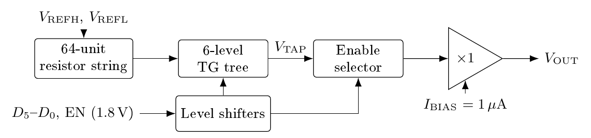
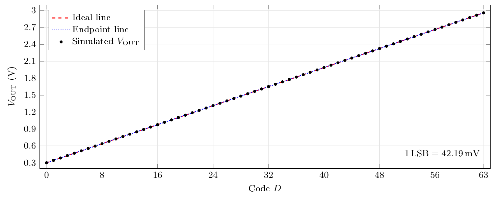
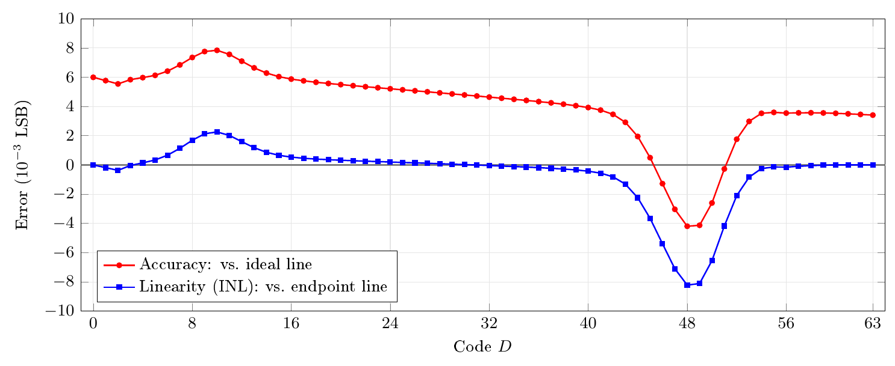

# Buffered 6-Bit Resistor-String DAC in Sky130

**ICARUS TEAM 4: Flatline**

## 1 Overview

A voltage-output, 6-bit resistor-string DAC with an integrated unity-gain output buffer, for Chipalooza Challenge #4 in Sky130. It holds a static voltage between two external references and drives a $100\,\mathrm{k\Omega} \parallel 20\,\mathrm{pF}$ load. Existing Sky130 Chipalooza DACs are AC-only (audio), current-output (IDAC), unbuffered for $\geq 100\,\mathrm{M\Omega}$ loads (8-bit RDAC) or short-term (12-bit CDAC); this block fills the gap for a static, buffered voltage DAC.

## 2 Applications

- Programmable comparator thresholds and trim or calibration voltages
- Low-frequency set points routed across the SoC or to a pin

## 3 Topology

- **Resistor string:** 64 matched $\approx 1\,\mathrm{k\Omega}$ poly units between $V_{\mathrm{REFH}}$ and $V_{\mathrm{REFL}}$; inherently monotonic
- **Tap selector:** 6-level binary tree of CMOS transmission gates, one level per bit, so no decoder is needed; $V_{\mathrm{TAP}} = V_{\mathrm{REFL}} + D\,(V_{\mathrm{REFH}} - V_{\mathrm{REFL}})/64$, $D = 0 \ldots 63$
- **Level shifters:** seven cross-coupled shifters convert $D_5$–$D_0$ and EN from $1.8\,\mathrm{V}$ logic to complementary $0/3.3\,\mathrm{V}$ switch drives
- **Output buffer:** complementary-input two-stage op-amp at unity gain, Miller-compensated ($60\,\mathrm{pF}$ MIM, $1.5\,\mathrm{k\Omega}$); $1\,\mu\mathrm{A}$ bias mirrored to $10\,\mu\mathrm{A}$ per input pair, $100\,\mu\mathrm{A}$ output
- **Enable:** EN low connects the buffer input to $V_{\mathrm{REFL}}$. Codes may change while EN is high; brief multi-bit glitches are expected

## 4 Pin List

| Pin | Function | Type |
|---|---|---|
| $D_5$–$D_0$ | Data code, $D_5$ = MSB (6 harness control inputs) | Digital in, $1.8\,\mathrm{V}$ |
| EN | Enable; low resets output to $V_{\mathrm{REFL}}$ (1 control input) | Digital in, $1.8\,\mathrm{V}$ |
| $V_{\mathrm{REFH}}$ | Upper reference, $3.0\,\mathrm{V}$; sources $\approx 42\,\mu\mathrm{A}$ (shared analog line) | Analog in |
| $V_{\mathrm{REFL}}$ | Lower reference, $0.3\,\mathrm{V}$; sinks $\approx 42\,\mu\mathrm{A}$ (shared analog line) | Analog in |
| $V_{\mathrm{TAP}}$ | Unbuffered tap; test port and fallback output (shared analog line) | Analog out |
| $V_{\mathrm{OUT}}$ | Buffered DAC output (dedicated pad, requested) | Analog out |
| $I_{\mathrm{BIAS}}$ | $1\,\mu\mathrm{A}$ mirrored harness current | Bias in |
| $V_{\mathrm{DDA}}$ | $3.3\,\mathrm{V}$ analog supply (per-slot switch) | Power |
| $V_{\mathrm{DDD}}$ | $1.8\,\mathrm{V}$ digital supply | Power |
| $V_{\mathrm{SS}}$ | Ground | Power |

Harness resources: 7 of 24 control inputs, 0 status outputs, 3 of 4 shared analog lines, 1 dedicated pad and 1 bias current.

## 5 Target Specifications

Conditions: $V_{\mathrm{REFL}} = 0.300\,\mathrm{V}$, $V_{\mathrm{REFH}} = 3.000\,\mathrm{V}$, load $100\,\mathrm{k\Omega} \parallel 20\,\mathrm{pF}$ (including pad, package and fixture). $1\,\mathrm{LSB} = 42.1875\,\mathrm{mV}$; errors are referred to the measured references.

| Parameter | Min | Typ | Max | Unit |
|---|:---:|:---:|:---:|---|
| Analog supply $V_{\mathrm{DDA}}$ | 3.135 | 3.3 | 3.465 | V |
| Digital supply $V_{\mathrm{DDD}}$ | 1.71 | 1.8 | 1.89 | V |
| Temperature | −20 | 25 | 110 | °C |
| Bias current $I_{\mathrm{BIAS}}$ | 0.8 | 1.0 | 1.2 | µA |
| Resolution | – | 6 | – | bit |
| Output range (code 0 to 63) | 0.300 | – | 2.958 | V |
| Absolute error, every code | −0.5 | – | +0.5 | LSB |
| DNL | −0.5 | – | +0.5 | LSB |
| INL (endpoint fit) | −0.5 | – | +0.5 | LSB |
| Monotonicity | | Guaranteed | | – |
| Settling after a code change, ±0.5 LSB | – | 10 | 20 | µs |
| Reference current $I_{\mathrm{REF}}$ | – | 42.2 | 60 | µA |
| Static analog current $I_{\mathrm{DDA}}$ (excl. $I_{\mathrm{REF}}$) | – | 0.3 | 1.0 | mA |
| Static digital current $I_{\mathrm{DDD}}$ | – | 5 | 50 | µA |

**Absolute limits:** $V_{\mathrm{DDA}}$ 0–3.6 V; $V_{\mathrm{DDD}}$ 0–1.95 V; references and $V_{\mathrm{OUT}}$ between $V_{\mathrm{SS}}$ and $V_{\mathrm{DDA}}$ with $V_{\mathrm{REFL}} < V_{\mathrm{REFH}}$; digital inputs between $V_{\mathrm{SS}}$ and $V_{\mathrm{DDD}}$; $I_{\mathrm{BIAS}} \leq 2\,\mu\mathrm{A}$; $V_{\mathrm{OUT}}$ must not be driven or shorted. Sky130 device and pad ratings take precedence.

**Basis for the values:** the 0.3/3.0 V references keep the buffer clear of both rails; the 1 kΩ unit balances reference current, area and settling; ±0.5 LSB is a common DAC target and 20 µs suits occasional threshold updates; 20 pF is our pad, package and fixture estimate; supply tolerance and the −20 °C limit are assumed until harness documentation is published (110 °C follows the Challenge #4 rules). All will be revisited after layout.

## 6 Verification Plan

- **Remaining:** port to Xschem/ngspice and CACE for open-source sign-off; layout with dummies and common-centroid inputs; DRC, LVS and PEX re-simulation over PVT; combined mismatch/PVT; harness switch, pad and $V_{\mathrm{TAP}}$ line models
- **Silicon:** 64-code sweep over SPI with references on a source/measure unit and a precision DMM (error, DNL, INL, monotonicity); $V_{\mathrm{TAP}}$ vs. $V_{\mathrm{OUT}}$ to separate string and buffer errors; scope settling and glitches ($0 \leftrightarrow 63$, $31 \leftrightarrow 32$); 100 kΩ and 1 MΩ loads; supply, $I_{\mathrm{BIAS}}$ and temperature extremes

Accuracy = +0.0078 LSB @ $D = 10$ · Linearity (INL) = −0.0082 LSB @ $D = 48$ · DNL = +0.0023 LSB @ $50 \to 51$ · Monotonic (min. step 42.11 mV)

*Sky130 pre-layout simulation (pinned BSIM, poly-resistor and MIM models), TT corner, nominal supplies, 100 kΩ ∥ 20 pF load. Resistors are identical in this run; mismatch is assessed separately.*

## 7 Deliverables

- Schematics, layout (GDS) and LEF views, testbenches, CACE results and DRC/LVS reports in a public Apache 2.0 repository
- Datasheet, bench measurement scripts and published silicon results
