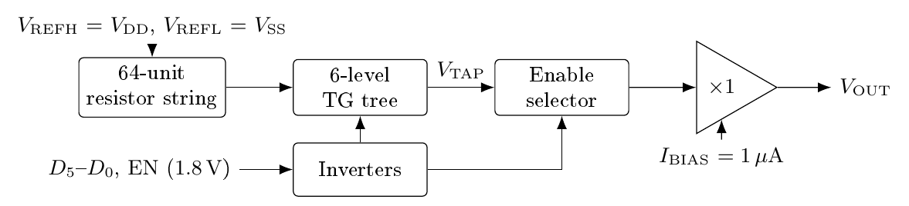
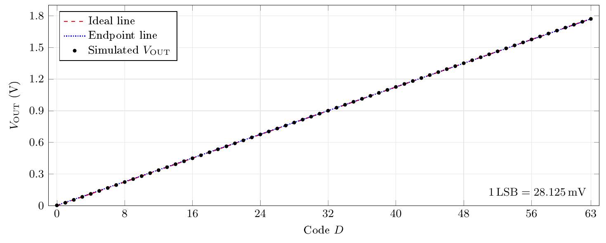
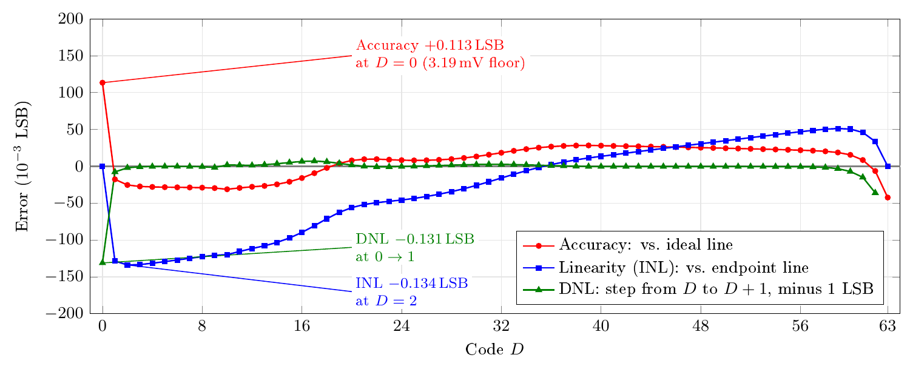

# 1.8 V Rail-to-Rail 6-Bit Buffered DAC in Sky130

**ICARUS TEAM 4: Flatline**

## 1 Overview

A voltage-output, 6-bit resistor-string DAC with an integrated unity-gain output buffer, for Chipalooza Challenge #4 in Sky130. The whole block runs from a single $1.8\,\mathrm{V}$ supply shared by the logic and analog circuitry, and the string spans the full rail ($V_{\mathrm{REFL}} = V_{\mathrm{SS}}$, $V_{\mathrm{REFH}} = V_{\mathrm{DD}}$), so the output is rail to rail: $0$ to $\tfrac{63}{64}V_{\mathrm{DD}}$ ($1.772\,\mathrm{V}$ at $1.8\,\mathrm{V}$). It holds a static voltage and drives a $100\,\mathrm{k\Omega} \parallel 20\,\mathrm{pF}$ load. Existing Sky130 Chipalooza DACs are AC-only (audio), current-output (IDAC), unbuffered for $\geq 100\,\mathrm{M\Omega}$ loads (8-bit RDAC) or short-term (12-bit CDAC); this block fills the gap for a static, buffered voltage DAC.

## 2 Applications

- Programmable comparator thresholds and trim or calibration voltages
- Low-frequency set points routed across the SoC or to a pin

## 3 Topology

- **Resistor string:** 64 matched $\approx 1\,\mathrm{k\Omega}$ poly units from $V_{\mathrm{SS}}$ to $V_{\mathrm{DD}}$; inherently monotonic, and ratiometric to the supply
- **Tap selector:** 6-level binary tree of $1.8\,\mathrm{V}$ CMOS transmission gates, one level per bit, so no decoder is needed; $V_{\mathrm{TAP}} = D\,V_{\mathrm{DD}}/64$, $D = 0 \ldots 63$
- **Switch drivers:** logic and switches share the $1.8\,\mathrm{V}$ supply, so no level shifters are needed; two inverters per bit (and for EN) give the complementary gate drives
- **Output buffer:** two-stage op-amp at unity gain with NMOS and PMOS input pairs, so it senses taps from $0\,\mathrm{V}$ to $V_{\mathrm{DD}}$ (rail-to-rail input); NMOS common-source output against a $100\,\mu\mathrm{A}$ PMOS source, Miller-compensated ($45\,\mathrm{pF}$ MIM, $1.5\,\mathrm{k\Omega}$ poly); $1\,\mu\mathrm{A}$ bias mirrored to $10\,\mu\mathrm{A}$ per input pair
- **Enable:** EN low connects the buffer input to $V_{\mathrm{REFL}}$ (ground). Codes may change while EN is high; brief multi-bit glitches are expected

## 4 Pin List

| Pin | Function | Type |
|---|---|---|
| $D_5$–$D_0$ | Data code, $D_5$ = MSB (6 harness control inputs) | Digital in, $1.8\,\mathrm{V}$ |
| EN | Enable; low resets output to $V_{\mathrm{REFL}}$ (1 control input) | Digital in, $1.8\,\mathrm{V}$ |
| $V_{\mathrm{REFH}}$ | Upper end of the string; tied to $V_{\mathrm{DD}}$ (no harness line) | Internal |
| $V_{\mathrm{REFL}}$ | Lower end of the string; tied to $V_{\mathrm{SS}}$ (no harness line) | Internal |
| $V_{\mathrm{TAP}}$ | Unbuffered tap; test port and fallback output (shared analog line) | Analog out |
| $V_{\mathrm{OUT}}$ | Buffered DAC output (dedicated pad, requested) | Analog out |
| $I_{\mathrm{BIAS}}$ | $1\,\mu\mathrm{A}$ mirrored harness current | Bias in |
| $V_{\mathrm{DD}}$ | $1.8\,\mathrm{V}$ supply for logic, string and buffer (per-slot switch) | Power |
| $V_{\mathrm{SS}}$ | Ground | Power |

Harness resources: 7 of 24 control inputs, 0 status outputs, 1 of 4 shared analog lines, 1 dedicated pad and 1 bias current.

## 5 Target Specifications

Conditions: $V_{\mathrm{REFL}} = V_{\mathrm{SS}}$, $V_{\mathrm{REFH}} = V_{\mathrm{DD}}$, load $100\,\mathrm{k\Omega} \parallel 20\,\mathrm{pF}$ (including pad, package and fixture). $1\,\mathrm{LSB} = V_{\mathrm{DD}}/64 = 28.125\,\mathrm{mV}$ at $1.8\,\mathrm{V}$; errors are referred to the measured supply. Typical values are pre-layout simulation results at TT, 25 °C, 1.8 V.

| Parameter | Min | Typ | Max | Unit |
|---|:---:|:---:|:---:|---|
| Supply $V_{\mathrm{DD}}$ (logic and analog) | 1.71 | 1.8 | 1.89 | V |
| Temperature | −20 | 25 | 110 | °C |
| Bias current $I_{\mathrm{BIAS}}$ | 0.8 | 1.0 | 1.2 | µA |
| Resolution | – | 6 | – | bit |
| Output, code 0 | 0 | 0.0032 | – | V |
| Output, code 63 | – | 1.7707 | $\tfrac{63}{64}V_{\mathrm{DD}}$ | V |
| Absolute error, every code | −0.5 | 0.11 | +0.5 | LSB |
| DNL | −0.5 | 0.13 | +0.5 | LSB |
| INL (endpoint fit) | −0.5 | 0.13 | +0.5 | LSB |
| Monotonicity | | Guaranteed | | – |
| Settling after a code change, ±0.5 LSB | – | 9.2 | 20 | µs |
| String current $I_{\mathrm{REF}}$ | – | 28.0 | 40 | µA |
| Static supply current $I_{\mathrm{DD}}$ (incl. $I_{\mathrm{REF}}$) | – | 0.17 | 0.5 | mA |

**Absolute limits:** $V_{\mathrm{DD}}$ 0–1.95 V; every signal pin between $V_{\mathrm{SS}}$ and $V_{\mathrm{DD}}$; $I_{\mathrm{BIAS}} \leq 2\,\mu\mathrm{A}$; $V_{\mathrm{OUT}}$ must not be driven or shorted. $V_{\mathrm{OUT}}$ and $V_{\mathrm{TAP}}$ reach the 3.3 V pad frame, so they need overvoltage protection (Challenge #4 Rule 10). Sky130 device and pad ratings take precedence.

**Basis for the values:** the single 1.8 V supply matches the harness logic and removes the level shifters; tying the string to the rails gives a rail-to-rail range and frees the two reference lines, at the cost of a supply-ratiometric output; the NMOS output stage bottoms out about 3 mV above ground, which sets the code-0 error (0.11 LSB); 45 pF compensation was chosen from a 20–60 pF sweep (phase margin 71.5° at TT and 69.0° at SS, 110 °C, 1.71 V; faster than 60 pF); the 1 kΩ unit sets 28 µA of string current; ±0.5 LSB is a common DAC target and 20 µs suits occasional threshold updates; 20 pF is our pad, package and fixture estimate; supply tolerance is assumed until harness documentation is published. The SF (−20 °C) and SS (110 °C) runs at 1.71 V stay within ±0.16 LSB and settle in ≤ 14.1 µs. All will be revisited after layout.

## 6 Verification Plan

- **Remaining:** port to Xschem/ngspice and CACE for open-source sign-off; FF and FS corners and combined mismatch/PVT; layout with dummies and common-centroid inputs; DRC, LVS and PEX re-simulation over PVT; overvoltage protection on $V_{\mathrm{OUT}}$ and $V_{\mathrm{TAP}}$; harness switch, pad and $V_{\mathrm{TAP}}$ line models
- **Silicon:** 64-code sweep over SPI with a precision DMM on $V_{\mathrm{OUT}}$ and $V_{\mathrm{DD}}$ (error, DNL, INL, monotonicity); $V_{\mathrm{TAP}}$ vs. $V_{\mathrm{OUT}}$ to separate string and buffer errors; scope settling and glitches ($0 \leftrightarrow 63$, $31 \leftrightarrow 32$); 100 kΩ and 1 MΩ loads; supply, $I_{\mathrm{BIAS}}$ and temperature extremes

Top: settled output versus code. Bottom: accuracy is the deviation from the ideal line; INL is the deviation from the endpoint line; DNL is the step-size error relative to $1\,\mathrm{LSB}$. One vertical-axis unit is $0.001\,\mathrm{LSB}$ ($28.1\,\mu\mathrm{V}$). The largest errors come from code 0, where the output stays 3.19 mV above ground. All steps are positive (minimum 24.44 mV, at $0 \to 1$).

*Sky130 pre-layout simulation (pinned BSIM, poly-resistor and MIM models), TT corner, 25 °C, 1.8 V, 100 kΩ ∥ 20 pF load. The LTspice schematics were re-simulated in ngspice to export every code; code 0 and code 63 agree with the LTspice run within 0.07 mV. Resistors are identical in this run; mismatch is assessed separately.*

## 7 Deliverables

- Schematics, layout (GDS) and LEF views, testbenches, CACE results and DRC/LVS reports in a public Apache 2.0 repository
- Datasheet, bench measurement scripts and published silicon results
