# CACE Summary for dac6_1v8

**netlist source**: schematic

This is the pre-layout characterization of the 1.8 V rail-to-rail 6-bit DAC in [`ltspice/sky130_1v8logic`](../ltspice/sky130_1v8logic). The device under test is the DAC core: control logic, resistor string, 64:1 transmission-gate tree, enable switch and buffer.

- **Tools.** CACE 2.13.0, ngspice 42 and xschem 3.4.4. The schematics, testbenches, datasheet and scripts are in [`ltspice/sky130_1v8logic_ngspice`](../ltspice/sky130_1v8logic_ngspice). That folder's README explains how to rerun everything.
- **Models.** The ngspice corner libraries come from SkyWater's open device models (`skywater-pdk-libs-sky130_fd_pr`), built by `tools/make_pdk_subset.sh`. At TT, SS and SF they reproduce the LTspice results to the microvolt.
- **Conditions.** Unless a row says otherwise:
  - VDDA = VREFH = 1.8 V, VREFL = 0 V
  - IBIAS = 1 µA
  - load 100 kΩ ∥ 20 pF
  - 25 °C, TT corner
- **"PVT" rows.** These cover the five MOS corners (TT, SS, FF, SF, FS), VDDA of 1.71, 1.8 and 1.89 V, and −20, 25 and 110 °C, which is 45 runs.
- **Monte Carlo.** 30 samples of device mismatch at TT and 25 °C.
- **Limits.** These are the targets from proposal v4: ±0.5 LSB for every static error, 20 µs settling, 40 µA string current and 0.5 mA supply current. Rows with "any" are measured and reported without a limit.

|      Parameter       |         Tool         |     Result      | Min Limit  |  Min Value   | Typ Target |  Typ Value   | Max Limit  |  Max Value   |  Status  |
| :------------------- | :------------------- | :-------------- | ---------: | -----------: | ---------: | -----------: | ---------: | -----------: | :------: |
| Absolute error (TT)  | ngspice              | error                |        -0.5 LSB | -0.074 LSB |        0 LSB |  0.016 LSB |      0.5 LSB |  0.114 LSB |   Pass ✅    |
| INL (TT)             | ngspice              | inl                  |        -0.5 LSB | -0.134 LSB |        0 LSB | -0.006 LSB |      0.5 LSB |  0.058 LSB |   Pass ✅    |
| DNL (TT)             | ngspice              | dnl                  |        -0.5 LSB | -0.123 LSB |        0 LSB | -0.000 LSB |      0.5 LSB |  0.034 LSB |   Pass ✅    |
| Absolute error (PVT) | ngspice              | error                |        -0.5 LSB | -0.145 LSB |            ​ |          ​ |      0.5 LSB |  0.141 LSB |   Pass ✅    |
| INL (PVT)            | ngspice              | inl                  |        -0.5 LSB | -0.187 LSB |            ​ |          ​ |      0.5 LSB |  0.166 LSB |   Pass ✅    |
| DNL (PVT)            | ngspice              | dnl                  |        -0.5 LSB | -0.190 LSB |            ​ |          ​ |      0.5 LSB |  0.042 LSB |   Pass ✅    |
| Smallest code step (monotonic if > 0) | ngspice              | min_step             |            0 mV |  22.038 mV |    28.125 mV |  24.551 mV |            ​ |          ​ |   Pass ✅    |
| Zero-code error (code 0) | ngspice              | zero_error           |             any |  0.075 LSB |            ​ |          ​ |      0.5 LSB |  0.141 LSB |   Pass ✅    |
| Full-scale error (code 63) | ngspice              | full_scale_error     |        -0.5 LSB | -0.145 LSB |            ​ |          ​ |      0.5 LSB | -0.029 LSB |   Pass ✅    |
| Gain error (code 0 to 63 span) | ngspice              | gain_error           |        -0.5 LSB | -0.254 LSB |            ​ |          ​ |      0.5 LSB | -0.108 LSB |   Pass ✅    |
| Staircase check, last-2-µs drift | ngspice              | unsettled            |               ​ |          ​ |            ​ |          ​ |     0.05 LSB |  0.018 LSB |   Pass ✅    |
| Buffer offset, VOUT - VTAP | ngspice              | buffer_offset        |             any |  -3.891 mV |            ​ |          ​ |          any |   4.153 mV |   Pass ✅    |
| String current IREF  | ngspice              | iref                 |               ​ |          ​ |            ​ |          ​ |        40 µA |  31.137 µA |   Pass ✅    |
| Static supply current (incl. IREF) | ngspice              | idd_total            |               ​ |          ​ |            ​ |          ​ |       500 µA | 191.589 µA |   Pass ✅    |
| Absolute error (IBIAS range) | ngspice              | error                |        -0.5 LSB | -0.078 LSB |            ​ |          ​ |      0.5 LSB |  0.115 LSB |   Pass ✅    |
| INL (IBIAS range)    | ngspice              | inl                  |        -0.5 LSB | -0.132 LSB |            ​ |          ​ |      0.5 LSB |  0.065 LSB |   Pass ✅    |
| Supply current (IBIAS range) | ngspice              | idd_total            |               ​ |          ​ |            ​ |          ​ |       500 µA | 202.506 µA |   Pass ✅    |
| INL (Monte Carlo)    | ngspice              | inl                  |        -0.5 LSB | -0.188 LSB |            ​ |          ​ |      0.5 LSB |  0.090 LSB |   Pass ✅    |
| DNL (Monte Carlo)    | ngspice              | dnl                  |        -0.5 LSB | -0.150 LSB |            ​ |          ​ |      0.5 LSB |  0.037 LSB |   Pass ✅    |
| Absolute error (Monte Carlo) | ngspice              | error                |        -0.5 LSB | -0.155 LSB |            ​ |          ​ |      0.5 LSB |  0.136 LSB |   Pass ✅    |
| Buffer offset (Monte Carlo) | ngspice              | buffer_offset        |             any |  -4.035 mV |            ​ |          ​ |          any |   3.546 mV |   Pass ✅    |
| Output with EN low   | ngspice              | vout_en              |               ​ |          ​ |            ​ |          ​ |        14 mV |   3.198 mV |   Pass ✅    |
| Supply current with EN low | ngspice              | idd_total            |               ​ |          ​ |            ​ |          ​ |          any | 156.426 µA |   Pass ✅    |
| Settling time, +-0.5 LSB | ngspice              | settling_time        |               ​ |          ​ |            ​ |          ​ |        20 µs |   8.723 µs |   Pass ✅    |
| Slew rate, full-scale step (10-90 %) | ngspice              | slew_rate            |             any | 0.314 V/µs |            ​ |          ​ |          any | 0.460 V/µs |   Pass ✅    |
| Overshoot or glitch past final value | ngspice              | overshoot            |               ​ |          ​ |            ​ |          ​ |          any |  24.233 mV |   Pass ✅    |
| Error at end of step test | ngspice              | final_error          |        -0.5 LSB | -0.112 LSB |            ​ |          ​ |      0.5 LSB |  0.203 LSB |   Pass ✅    |
| DC loop gain         | ngspice              | dc_gain              |             any |  15.325 dB |            ​ |          ​ |            ​ |          ​ |   Pass ✅    |
| Unity-gain frequency | ngspice              | ugf                  |             any |  0.040 MHz |            ​ |          ​ |            ​ |          ​ |   Pass ✅    |
| Phase margin         | ngspice              | phase_margin         |            45 ° |   74.804 ° |            ​ |          ​ |            ​ |          ​ |   Pass ✅    |
| Gain margin          | ngspice              | gain_margin          |           10 dB |  25.494 dB |            ​ |          ​ |            ​ |          ​ |   Pass ✅    |
| PSRR at 10 Hz        | ngspice              | psrr_dc              |             any |  45.452 dB |            ​ |          ​ |            ​ |          ​ |   Pass ✅    |
| PSRR at 10 kHz       | ngspice              | psrr_10k             |             any |  36.934 dB |            ​ |          ​ |            ​ |          ​ |   Pass ✅    |
| PSRR at 1 MHz        | ngspice              | psrr_1m              |             any |  12.229 dB |            ​ |          ​ |            ​ |          ​ |   Pass ✅    |

All 34 results pass. CACE wrote the rows from four runs of the same datasheet. After the first run, two things changed: the static testbench moved from a DC sweep to a settled transient staircase, and the step script's slew and overshoot measurements were fixed. Only the affected parameters were run again. The rows come from:

- `RUN_2026-11-25_17-18-36`: TT, IBIAS range and Monte Carlo static rows
- `RUN_2026-11-25_17-46-00`: PVT static rows
- `RUN_2026-11-25_18-02-30`: settling
- `RUN_2026-11-25_16-24-30`: EN low, buffer loop and PSRR

The "Typ Value" column is filled only where the datasheet gives a typical target.

## What the results say

- **Static accuracy has a wide margin.** Over all 45 PVT runs:
  - absolute error: −0.15 to +0.14 LSB
  - INL: −0.19 to +0.17 LSB
  - DNL: −0.19 to +0.04 LSB
  
  Over 30 mismatch samples, the worst INL is 0.19 LSB. The smallest code step anywhere is 22.0 mV (0.78 LSB), so the DAC is monotonic in every run.
- **The buffer sets the error, not the resistor string.**
  - Most of the error is at the two ends of the range. Code 0 sits 2.2–4.2 mV above ground. Code 63 sits 0.03–0.15 LSB below its ideal value, which gives a gain error of −0.11 to −0.25 LSB.
  - The buffer's DC loop gain explains this. It is 70–72 dB at mid-range, 32–39 dB at 28 mV and only 15–25 dB at 1.77 V.
  - Away from the ends, VOUT tracks VTAP within ±2 mV at the nominal corners. Including mismatch, the tracking stays within about ±4 mV.
- **The buffer is stable with margin.** Phase margin is 75–97° and gain margin at least 25 dB over all corners, temperatures and the three input levels. The unity-gain frequency is 40–580 kHz; it is lowest near the rails, where the loop gain is low.
- **Settling is well inside the 20 µs target.**
  - Full-scale steps settle to ±0.5 LSB of the final value in 5.9–8.7 µs. The worst case is 0→63 at SF and −20 °C.
  - Slew is 0.31–0.46 V/µs.
  - Midscale steps (31↔32) settle in under 1 µs. They show a switching glitch of up to 24 mV (0.85 LSB) at FS and 110 °C. In this test all six bits switch at exactly the same instant, so the glitch on silicon will depend on bit timing.
  - Proposal v4 quotes 9.2 µs. That LTspice figure counts settling into ±0.5 LSB of the *ideal* code voltage. Near the rails the static error already uses up 0.1–0.2 LSB of that band, so the ideal-band figure is a little longer than the final-value figure here.
- **EN low does not save power.** With EN low, the output goes to 2.5–3.2 mV as intended. The supply current stays at the enabled value (about 151 µA at TT), because EN only switches the buffer input to VREFL. If the harness expects a low-power off state, the buffer bias needs its own switch.
- **Supply current.** The total is 84–192 µA over PVT, including the 25–31 µA string current, and it peaks at mid-codes. At IBIAS = 1.2 µA, it reaches 203 µA. Both are well under the 0.5 mA limit.
- **Supply rejection.** VDDA ripple is measured with the references held fixed, so the output's intended tracking of VDDA through VREFH is not counted. Rejection is 45–48 dB at low frequency and 37–38 dB at 10 kHz. It is weakest, 10–13 dB, around 0.5 MHz, near the buffer's unity-gain frequency. In the real design VREFH is VDDA, so supply ripple also reaches the output through the string: code/64 of the ripple, by design.
- **The ngspice netlist matches LTspice.** At TT, code 63 is 1.77068 V in both. Code 0 is 2.77 mV here against 3.19–3.26 mV in the LTspice run. The LTspice number is sampled 60 µs after the supply ramp, before the output's slow tail near ground has finished; the staircase here holds code 0 for 30 µs from a settled operating point.

## Limits of these results

- These are schematic results only. Wiring resistance and capacitance, and the layout-dependent effects of long-channel devices, are not included.
- The Monte Carlo covers device mismatch only (`MC_MM_SWITCH = 1`). Wafer-to-wafer process spread is covered by the five corners instead. The resistor-only corners (`hh`, `ll`) are in the model library but were not run.
- A plain DC sweep of the codes sometimes converged to a false operating point at code 1: about 0.5 V at the output while VTAP was 27 mV. A transient at the same corner settles correctly. The static parameters therefore use a transient staircase, with a check that every code moved less than 0.05 LSB in its last 2 µs (worst 0.018 LSB).
- Noise, the overvoltage protection required by Chipalooza Rule 10, and the harness pads and switches are not part of this netlist.

## Plots

Plots drawn by CACE from the datasheet's `plot:` entries. The `dnl` and `dnl_pvt` plots put each step at its lower code.

## transfer_function

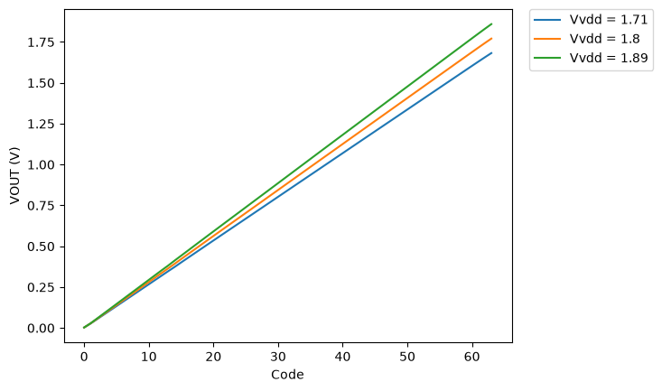

## error_per_code

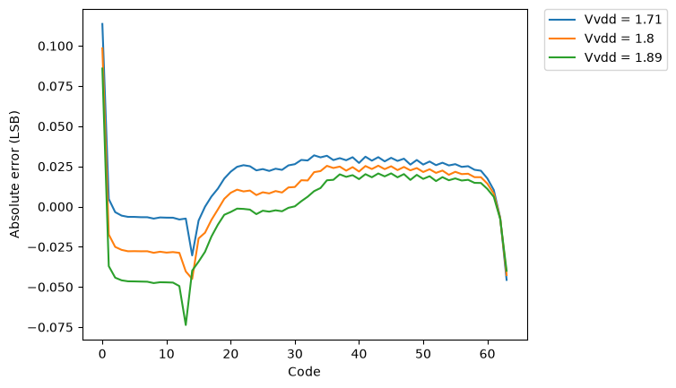

## inl

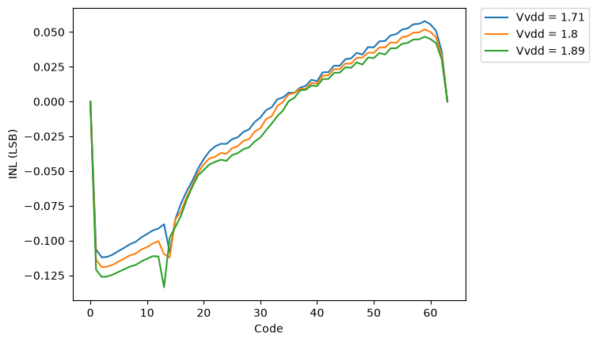

## dnl

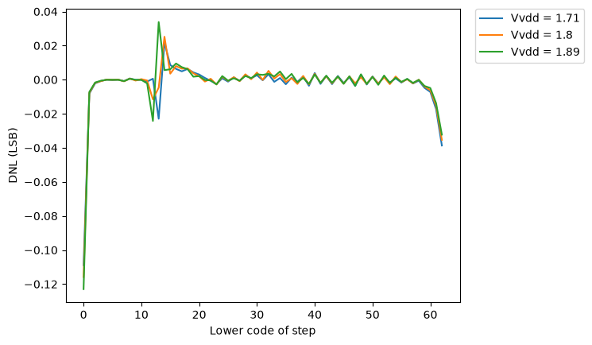

## buffer_offset

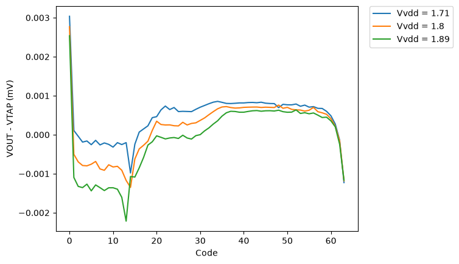

## inl_pvt

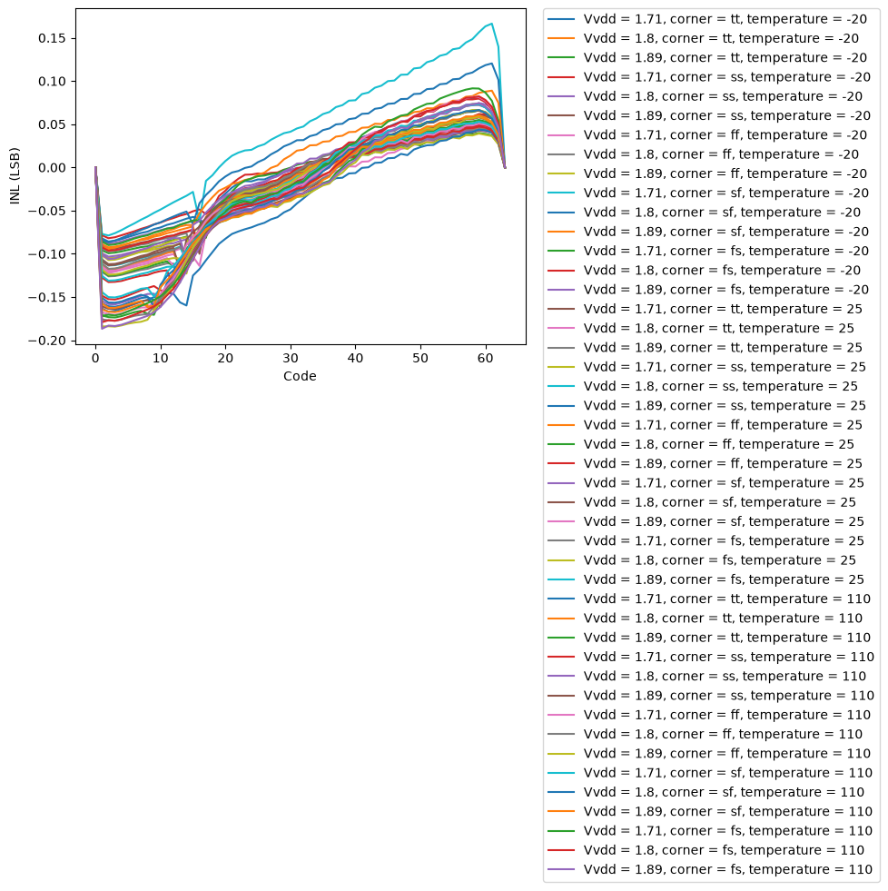

## dnl_pvt

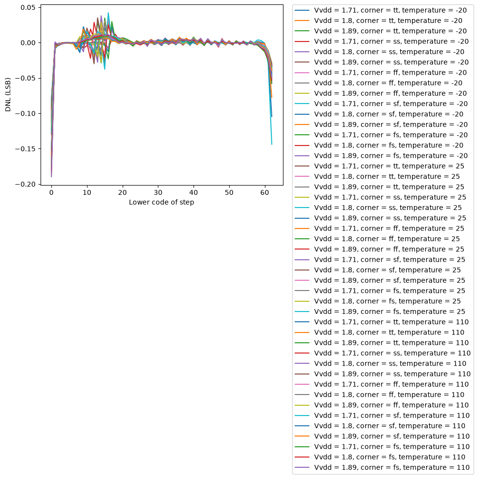

## Supplementary graphs

These were made from the same CACE run data by `tools/make_plots.py`. CACE's own plots use linear axes and one legend entry per run, which does not work for frequency sweeps or 45-run overlays.

### Static accuracy over PVT

The band is the range over all 45 PVT runs. The line is TT, 1.8 V and 25 °C.

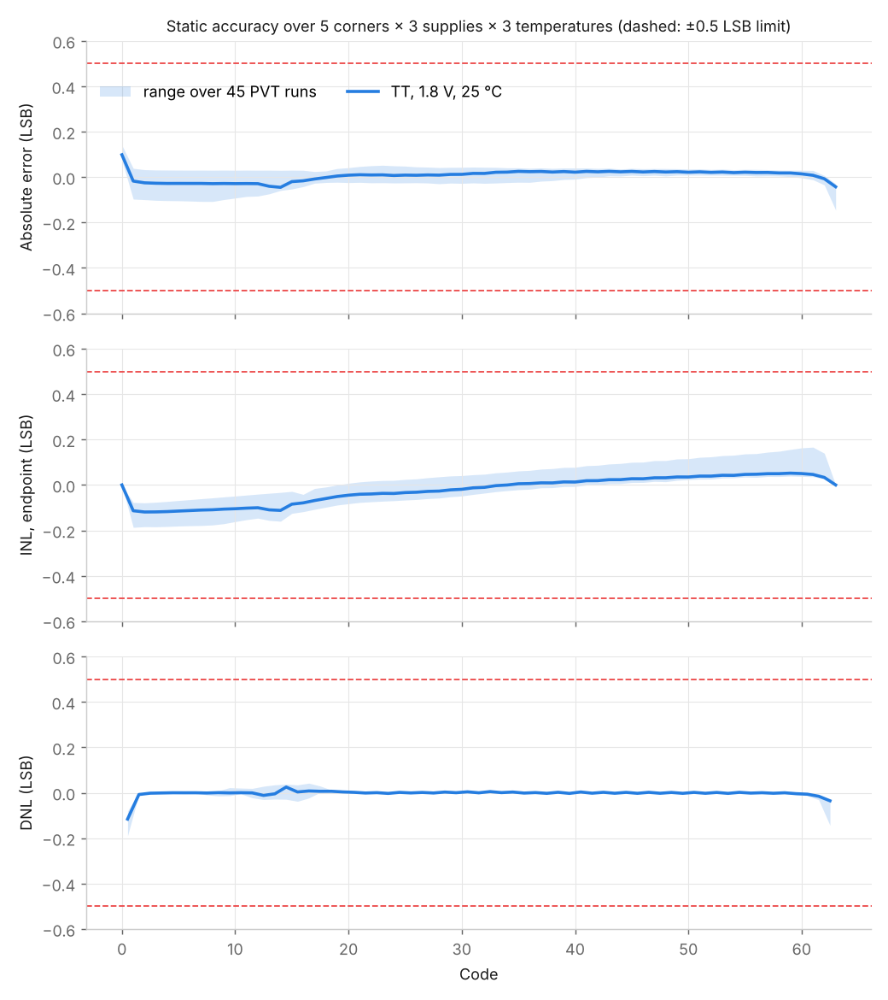

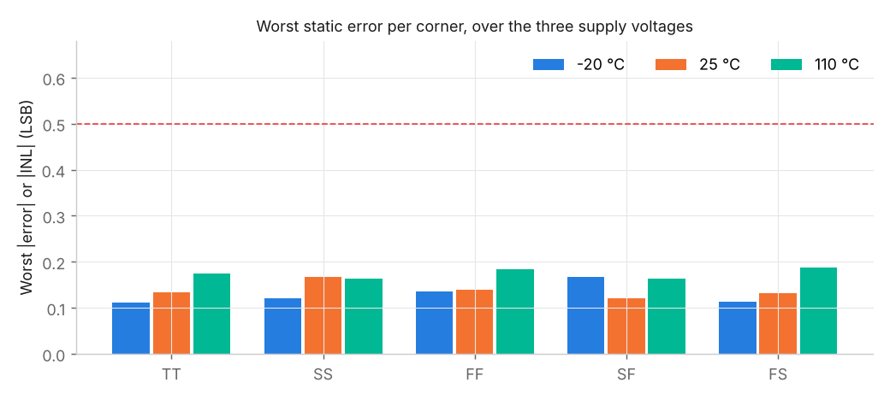

### Monte Carlo (mismatch, 30 samples)

INL per sample, and each sample's worst INL, DNL and absolute error. The buffer offset at code 32 has a mean of 0.37 mV and a standard deviation of 1.15 mV.

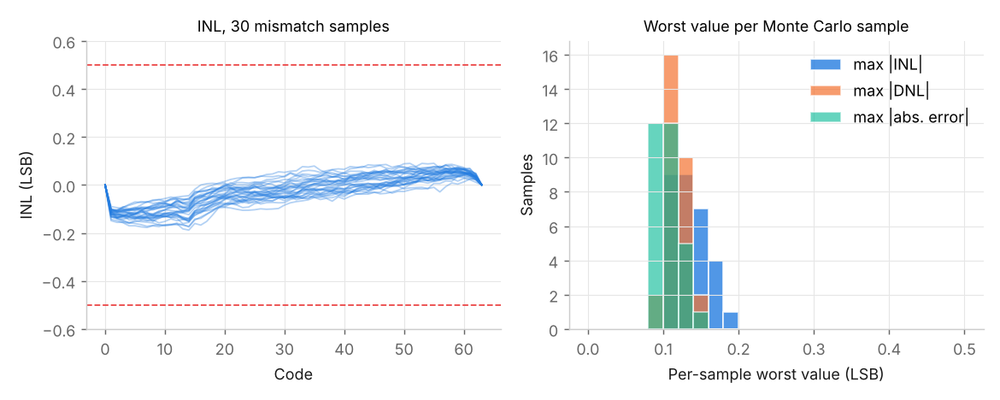

### Buffer offset per corner

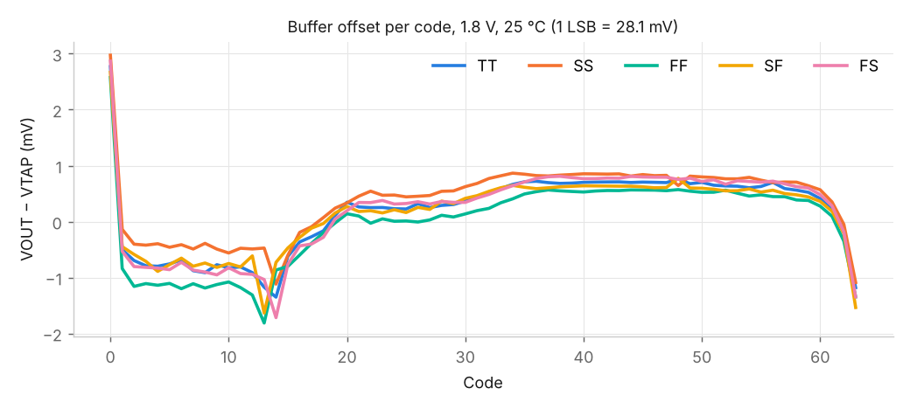

### Supply current

Read at the end of each staircase step, including the string current.

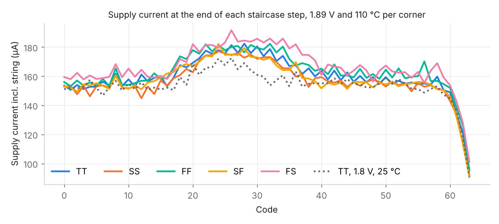

### Code steps

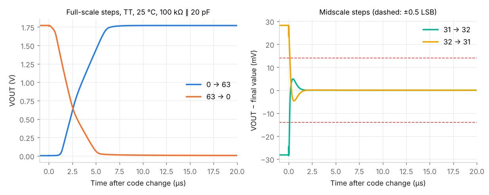

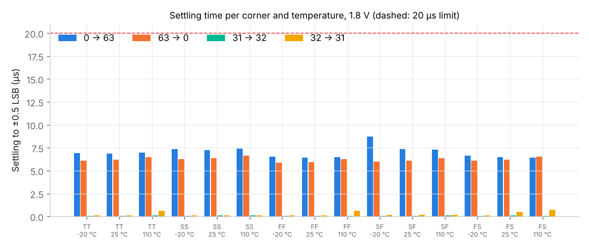

### Buffer loop gain

Loop broken at the inverting input, with the DAC load. Input at code 1, mid-range and code 63.

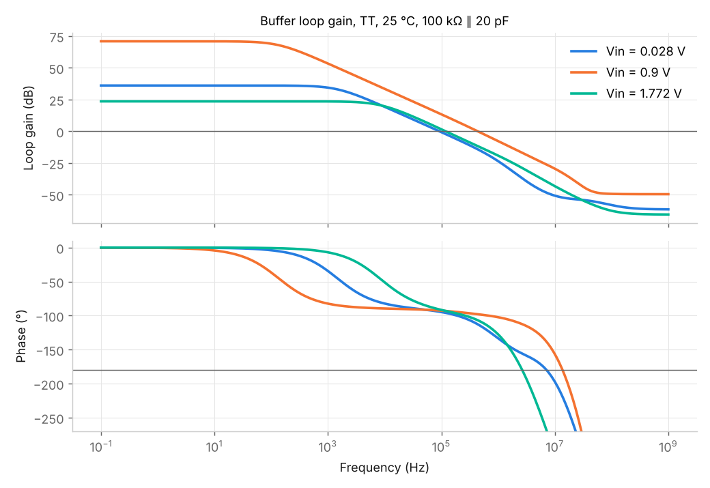

### Supply rejection

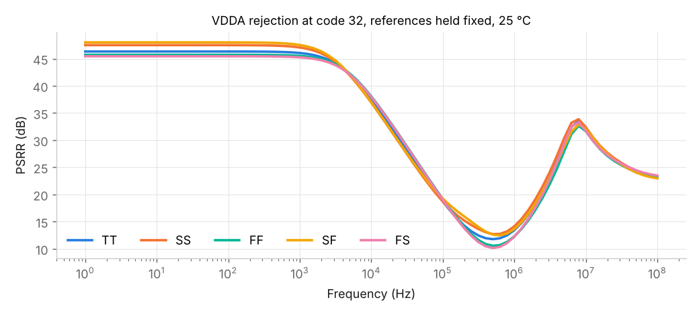
