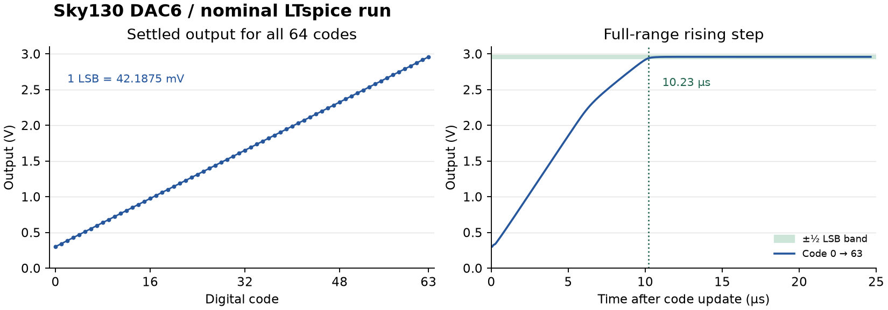

# Sky130 buffered 6-bit resistor-string DAC

**Open [DAC6_Sky130_Top.asc](DAC6_Sky130_Top.asc) in LTspice and click Run.** Download or clone the repository so the entire `sky130_dac6` folder stays together. Tested with LTspice 26.1.1 on macOS. The project uses standard LTspice symbols and bundled files with relative paths, so the same folder is intended for Windows and macOS. LTspice is the only required installation.

Click **OUT** to plot the buffered output and **TAP** to plot the selected resistor tap. The first 6.4 ms cover all 64 codes in 100 µs slots. The rest of the run exercises large steps, the 31 → 32 carry and enable/reset. Read `out0` and `out63` in the **SPICE Error Log** for the two settled endpoints.

At TT, 25 °C and 100 kΩ in parallel with 20 pF, the run gives **0.300253 V** at code 0 and **2.957956 V** at code 63. The nominal step is **42.1875 mV**. The minimum simulated step is **42.11259 mV**, and the worst measured settling time is **10.23 µs** into the ideal output ±½ LSB band. These are pre-layout results with nominal resistor matching and ideal testbench supplies and references.

## Change the test on the same sheet

Right-click the two `.param` lines at the bottom of the top sheet to edit the supply voltages (`AVDD`, `DVDD`), bias current (`IREF`), temperature in °C (`TEMP_C`), reference voltages (`REF_L`, `REF_H`), and output load (`RL`, `CL`). `DVDD` also sets the high level of the digital inputs. The reference settings default to 0.3 V and 3.0 V.

To change the MOS corner, replace the file in the `.include models/sky130_tt.lib` directive. Keep one corner include active. The bundled suffixes are `tt`, `ss`, `ff`, `sf` and `fs`. The adapter include and temperature directives should stay in place.

| Example | Model | AVDD | DVDD | IREF | TEMP_C | RL | CL |
| --- | --- | ---: | ---: | ---: | ---: | ---: | ---: |
| Nominal | TT | 3.3 | 1.8 | `1u` | 25 | `100k` | `20p` |
| Hot, low supply | SS | 3.135 | 1.71 | `0.8u` | 110 | `100k` | `20p` |
| Hot, high supply | FF | 3.465 | 1.89 | `1.2u` | 110 | `100k` | `20p` |
| Cold stress test | SF | 3.465 | 1.71 | `0.8u` | −40 | `100k` | `20p` |
| Deliberate overload | TT | 3.3 | 1.8 | `1u` | 25 | `1k` | `20p` |

- **Mask updates with EN.** Change the file on the `VEN` voltage source from `stimulus/enable.txt` to `stimulus/enable_masked.txt` and keep `VALUE_SCALE_FACTOR={DVDD}`. This holds EN low while the code changes and gives the data 5 µs to settle before enabling. The first enable edge at startup begins at 20 µs.
- **Test loading on TAP.** Connect a 10 MΩ resistor and a 10 pF capacitor from TAP to ground to represent a passive probe.
- **Try the deliberate overload.** With `RL=1k`, code 63 is expected to fall well short of its 2.958 V ideal output because the buffer cannot supply the required current.

## Read the circuit

Right-click **XCORE** to open the core. Inside it, follow the signal from the resistor string through the enable selector to the output buffer. Right-click each block to open its sheet.

| Block | What it does |
| --- | --- |
| Control | Level shifts D0–D5 and EN from the logic supply to complementary analogue-domain controls. |
| Resistor string and selector | Divides the reference span into 64 intervals. The six-bit transmission-gate tree selects taps 0–63. |
| Enable selector | Sends TAP to the buffer when enabled and VREFL when disabled. |
| Buffer | A unity-gain amplifier with complementary input pairs, a bias mirror, and a Miller-compensated output stage. Its purpose is to drive the load without pulling current directly from the selected tap. |

## What to keep

| File or folder | Purpose |
| --- | --- |
| `DAC6_Sky130_Top.asc` | The single testbench to open and run. |
| `blocks/` | The child `.asc` schematics and their matching `.asy` symbols. Both are needed for LTspice to resolve the hierarchy. |
| `models/` | The bundled Sky130 BSIM and passive models, LTspice adapters, and upstream licence. The top sheet selects the active model library. |
| `stimulus/` | The time and 0/1 level pairs read by the digital sources. LTspice scales the levels to `DVDD`. These files are simulation inputs. |
| `figures/` | Documentation image. |

LTspice generates waveforms, logs and netlists locally. This folder can be run without Python, a separate PDK, or custom LTspice search paths.

## Model provenance

The device cards come from the [SkyWater primitive device library at commit `29b5515`](https://github.com/fossi-foundation/skywater-pdk-libs-sky130_fd_pr/tree/29b55153fd9f4badef05a02667184b81789d1f61), under the [Apache 2.0 licence](models/LICENSE). The includes are flattened for portability. The adapter keeps schematic dimensions in micrometres, converts to the units used by LTspice, and implements parallel device multiplicity. Resistor temperature expressions use `PDK_TEMP`, set from `TEMP_C`. The physical implementation still needs parasitic extraction and pad, harness and mismatch verification.

The [earlier design report and independent buffer checks](https://github.com/AlexZGray/Chipalooza/tree/a1599b5/ltspice/sky130_dac6) remain in Git history.
