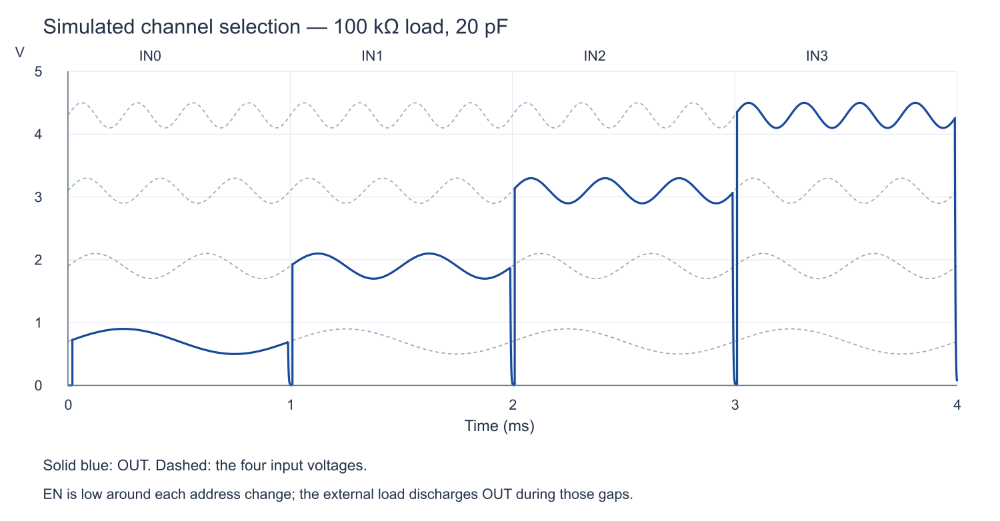

# LTspice 4:1 CMOS analog mux

A complete, editable transistor-level example with a 5 V supply, four analog inputs, two address bits and active-high enable. Each transmission gate and each decoder gate opens as its own schematic.

## Quick start

1. Clone the repository or extract its ZIP download. Keep **all files in this directory together**, including the `.asy`, `.asc`, `.lib`, `.plt` and stimulus `.txt` files. Downloading only one schematic will omit its dependencies.
2. Install [LTspice](https://www.analog.com/ltspice). The supplied examples were verified with **LTspice 26.1.1**. No third-party model downloads, foundry PDK, Python packages or global symbol-library installation are required to run the circuits.
3. Open **[Mux4_Complete.asc](Mux4_Complete.asc)** and choose **Run**.
4. The adjacent `Mux4_Complete.plt` configures the four input traces and OUT over 8 ms. If the plot does not appear automatically, open the matching `.plt` from the waveform viewer or add `V(in0)` through `V(in3)` and `V(out)` manually.
5. Right-click a hierarchical block and open its schematic to inspect the circuit inside. The matching lower-level `.asc` files can also be opened directly. The supplied `.save` directives retain internal voltages and MOSFET drain currents for probing through the hierarchy.

The graphical workflow applies to LTspice on Windows and macOS; menu wording can vary by version. The examples use relative dependency filenames and do not rely on a contributor's local installation path.

## Choose an example

| Open this file | Purpose | Output load |
|---|---|---|
| [Mux4_Complete.asc](Mux4_Complete.asc) | Full runnable assembly: four transmission gates, decoder, sources, supply and load | 100 kΩ / 20 pF |
| [Mux4_Testbench.asc](Mux4_Testbench.asc) | Same circuit behind a reusable whole-mux symbol | 100 kΩ / 20 pF |
| [Mux4_Heavy_Load.asc](Mux4_Heavy_Load.asc) | Deliberate loading test showing switch-resistance error | 1 kΩ / 20 pF |

Run each example as a separate top-level schematic. Leaf schematics have ports instead of independent supplies, sources and analysis directives, so they are intended to run inside these examples.

[Complete schematic preview](docs/schematic.png) · [Decoder preview](docs/decoder.png)

## Files and hierarchy

The reusable blocks have matching `.asc` schematic and `.asy` symbol files. LTspice resolves these blocks from this directory.

| Block / file | Contents |
|---|---|
| `Mux4.asc` / `Mux4.asy` | Reusable four-input mux: four TG blocks plus one decoder |
| `CMOS_Decoder2to4.asc` / `.asy` | Two address inverters, four NAND3 gates and four channel inverters |
| `CMOS_TG.asc` / `.asy` | NMOS and PMOS in parallel, with explicit body terminals |
| `CMOS_INV.asc` / `.asy` | Two-transistor CMOS inverter |
| `CMOS_NAND3.asc` / `.asy` | Three parallel PMOS pull-ups and three series NMOS pull-downs |
| `Mux4_Models.lib` | Generic NMOD / PMOD model definitions |
| `select_s0.txt`, `select_s1.txt`, `enable.txt` | Digital stimulus, including blanking around address changes |
| `Mux4_*.plt` | Saved waveform configuration for the three runnable examples |
| `verify_results.py` | Optional standard-library Python check of completed simulations |
| `results/reference.json` | Small reference measurement summary |
| `docs/` | Schematic previews and reference waveform plot |

```text
Mux4_Complete
├── CMOS_TG × 4
│   └── NMOS + PMOS
└── CMOS_Decoder2to4
    ├── CMOS_INV × 2       address complements
    ├── CMOS_NAND3 × 4     enabled address decode
    └── CMOS_INV × 4       complementary switch controls
```

`Mux4_Testbench` adds the reusable `Mux4` block above the same hierarchy. Both forms contain 44 MOSFETs. Matching net labels connect the decoder outputs D0…D3 and D0B…D3B to the switches. VSS is tied to ground in the runnable examples.

## Controls and expected waveforms

| EN | S1 | S0 | Connection |
|---|---|---|---|
| 0 | X | X | All inputs disconnected |
| 1 | 0 | 0 | IN0 ↔ OUT |
| 1 | 0 | 1 | IN1 ↔ OUT |
| 1 | 1 | 0 | IN2 ↔ OUT |
| 1 | 1 | 1 | IN3 ↔ OUT |

S1 is the most significant address bit; X means either value. The selected NMOS gate receives 5 V and the selected PMOS gate receives 0 V. Unselected pairs receive the opposite controls. The signal path is unbuffered and bidirectional within the supply rails.

The input sources are:

| Input | Waveform |
|---|---|
| IN0 | `SINE(0.7 0.2 1k)` |
| IN1 | `SINE(1.9 0.2 2k)` |
| IN2 | `SINE(3.1 0.2 3k)` |
| IN3 | `SINE(4.3 0.2 4k)` |

The 8 ms transient selects each input for approximately 1 ms, then repeats the four-channel sequence. EN starts low, goes high after 20 µs, goes low 10 µs before each address boundary and returns high 10 µs after it. It goes low again at 7.9 ms.



The combinational decoder **does not generate automatic break-before-make timing**. For channel changes, take EN low, allow the switches to turn off, change S1/S0, let the decoder settle and then reenable. The generous testbench delays are demonstration settings, not characterized timing limits.

When disabled, the mux disconnects OUT; it does not actively drive it to 0 V. The external load discharges the output capacitance, which explains the downward gaps in the plot.

## Reuse the mux

Copy `Mux4.asc`, `Mux4.asy`, all `CMOS_*.asc` / `CMOS_*.asy` files and `Mux4_Models.lib` together into your circuit directory. Place the local `Mux4` symbol and connect all ten pins:

| Pins | Purpose |
|---|---|
| IN0…IN3 | Analog terminals, 0–5 V in this example |
| OUT | Common analog terminal |
| S1, S0 | Address, 0/5 V logic |
| EN | Active-high enable, 0/5 V logic |
| VDD, VSS | 5 V and ground for this example |

Add the model include **once in the parent circuit**:

```spice
.include Mux4_Models.lib
```

Add your own sources, load and simulation analysis. The reusable `Mux4` schematic contains none of those testbench parts. `Mux4_Testbench.asc` demonstrates every external connection.

## Reproduce the checks

Run all three examples in LTspice and allow each to finish at 8 ms. To check their resulting binary `.raw` files automatically, optionally install Python 3.9 or later and run from the repository root:

```sh
python3 simulations/ltspice/verify_results.py
```

On Windows, `py -3` can be used instead of `python3`. The checker needs no additional Python packages and exits nonzero on failure. It reads files beside itself regardless of the current working directory; `--directory PATH` selects a different results folder. It supports ordinary and FastAccess real binary RAW files, with single- or double-precision signal data. Leave the example's `.tran`, stimulus and `.save` settings intact when using these reference checks.

The checks cover all four selections, disabled decoder levels, settled output error, discharge through the external load, deliberate heavy-load attenuation, and agreement between the complete assembly and reusable-symbol example. Switching and settling windows are excluded from the settled-error measurements.

[Reference results](results/reference.json) were generated with LTspice 26.1.1. Settled error was below **1.1 mV** into 100 kΩ; a 1 kΩ load caused approximately **2.3–2.8%** mean attenuation. The two mux representations agreed within **2.1 µV** at the comparison points. Exact adaptive timestep counts may vary by simulator version and settings.

Large raw files, generated netlists, logs, backups and personal files are ignored by Git. They are recreated when you run the examples; committed `.plt` files are intentional shared plot settings.

## Model assumptions and limits

This reference uses illustrative four-terminal **Level-1 monolithic CMOS models**, not a vendor model or Sky130 PDK. Body terminals are explicitly tied to their local supply rails. No third-party proprietary model file is redistributed.

| Parameter | NMOS | PMOS |
|---|---|---|
| Threshold VTO | +0.7 V | −0.7 V |
| KP | 120 µA/V² | 60 µA/V² |
| Switch W/L | 100 µm / 1 µm | 200 µm / 1 µm |
| Inverter W/L | 10 µm / 1 µm | 20 µm / 1 µm |
| NAND3 W/L | 30 µm / 1 µm per series device | 20 µm / 1 µm per parallel device |

The models also include body effect, channel-length modulation and lumped 1 pF source/body and drain/body junction capacitances. Those capacitances help the simplified model resolve transitions at weakly constrained internal nodes. Gear integration and 100 ns control edges are used in the examples.

LTspice may report that the illustrative dimensions are outside its recommended Level-1 range. These models demonstrate topology and functional selection; their results do not establish production bandwidth, distortion, leakage, charge injection, propagation delay, reliability or manufacturability. Foundry models, suitable supply/interface choices and process/corner verification are needed for an IC implementation.

Ordinary three-terminal discrete MOSFETs cannot directly replace these four-terminal monolithic devices because their body ties and body diodes differ. Keep switched signals within the supply rails, use a high-impedance receiver, and account for settling before sampling.
