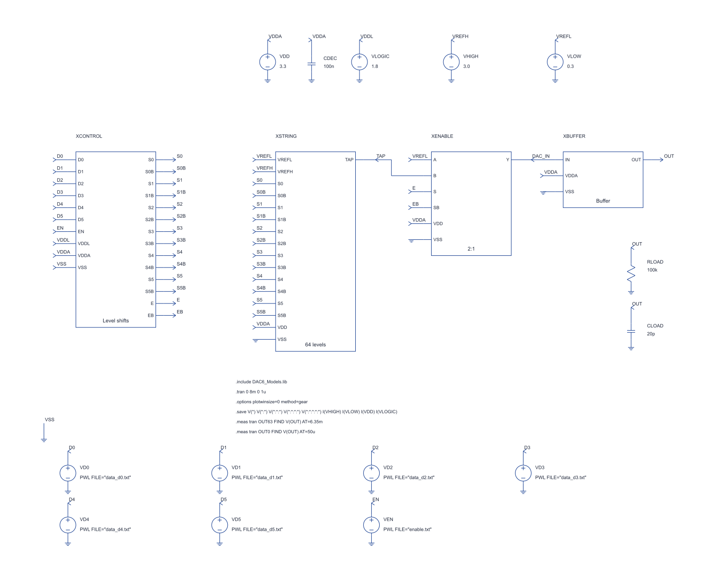
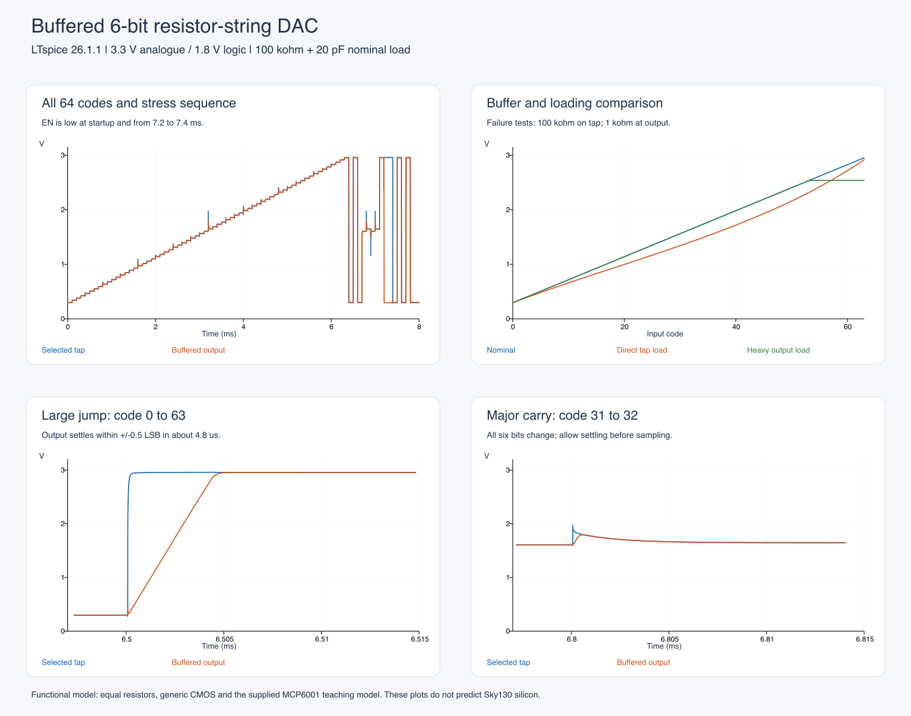

# Chipalooza: buffered 6-bit resistor-string DAC

A runnable, editable **LTspice architecture demonstrator** for the proposed Chipalooza Challenge #4 project. Open **[DAC6_Top.asc](DAC6_Top.asc)** and run that sheet. Its child blocks open as schematics, including the CMOS switches, level shifters and buffer feedback circuit.

**Status:** functionally verified in LTspice 26.1.1. The resource allocation and supply domains fit the published Challenge #4 rules. This is **not a completed Sky130 IC or competition sign-off**: switches use generic CMOS models and the output buffer uses the included MCP6001 teaching macromodel. The transistor amplifier, foundry models, resistor matching, physical layout and post-layout verification remain project work.

## Open and run

1. Clone [the repository](https://github.com/AlexZGray/Chipalooza) or use **Code → Download ZIP** and extract it. Open this `simulations/ltspice/dac6` folder. Keep the `.asc`, `.asy`, `.lib`, model `.txt`, waveform `.txt` and `.plt` files together.
2. Open **[DAC6_Top.asc](DAC6_Top.asc)** in LTspice and choose Run. No global symbol installation or external model download is needed.
3. The analysis is `.tran 0 8m 0 1u`: 8 ms with a maximum 1 us timestep and adaptive refinement during transitions. The matching `.plt` shows the selected tap, buffer input and output, with the digital controls underneath. Add traces manually if your LTspice version does not restore the plot.
4. Right-click a block to open its child schematic. Probe internal nodes after running the parent. The top sheet saves voltages through the hierarchy.
5. To reproduce the numerical checks, run all three top-level sheets, then run `python3 verify_results.py` in this folder. The checker uses Python's standard library. LTspice alone is sufficient to run and inspect the circuits.

Only the three `DAC6_*.asc` files are standalone testbenches. The other `.asc` files are child sheets supplied by parent ports; they do not contain independent sources or simulation commands.



## Proposed operating point

These are design choices for a manageable first project, **not performance values prescribed by the competition**.

| Item | Demonstrator setting / proposed initial target |
|---|---|
| Function | 6-bit voltage-output resistor-string DAC with buffer |
| Supplies | VDDA = 3.3 V; VDDL = 1.8 V; common ground |
| Digital inputs | D5…D0 and EN; 0/1.8 V, D5 most significant |
| Reference inputs | VREFL = 0.3 V; VREFH = 3.0 V, externally driven |
| Resistor string | 64 equal 1 kohm sections, 64 kohm total |
| Ideal step, 1 LSB | (3.0 − 0.3)/64 = **42.1875 mV** |
| Ideal output | 0.300000 V at code 0; 2.9578125 V at code 63 |
| Specified nominal load | 100 kohm in parallel with 20 pF, to ground |
| Initial accuracy target | Absolute settled error ≤ 0.5 LSB; DNL/INL ≤ 0.5 LSB; monotonic |
| Initial settling target | ≤ 20 us to the ideal output ±0.5 LSB under the specified load |
| Demonstrated update spacing | 100 us, or 10,000 updates/s; maximum rate not characterized |
| Disabled state | Reset buffer input to VREFL; buffer and ladder stay powered |

Using 0.3–3.0 V references leaves headroom for a realizable 3.3 V amplifier. A full 0–3.3 V output range would create a more difficult amplifier specification. Supply and reference tolerances, operating temperature range and absolute limits must be fixed with the selected PDK devices before the proposal is finalized; nominal success does not establish those ranges.

## How the stages work

### 1. Reference sources and resistor string

VHIGH and VLOW on the top sheet represent **external reference equipment**, not an on-chip reference generator. The 64 equal resistors divide their difference into equal increments. The ideal selected voltage for unsigned input code D is:

`Vtap = VREFL + D × (VREFH − VREFL)/64`, with `D = 0…63`.

There are 64 selectable voltages: the lower endpoint and 63 interior taps. The upper reference is deliberately not selected; a conventional 6-bit DAC full-scale code is 63/64 of the reference span.

| Code | Binary D5…D0 | Ideal selected voltage |
|---:|:---:|---:|
| 0 | 000000 | 0.3000000 V |
| 1 | 000001 | 0.3421875 V |
| 31 | 011111 | 1.6078125 V |
| 32 | 100000 | 1.6500000 V |
| 63 | 111111 | 2.9578125 V |

The nominal string current is 2.7 V / 64 kohm = **42.1875 uA**; resistor dissipation is **113.91 uW**. The upper reference must source this current and the lower reference must absorb it. The simulator's ideal voltage sources do both. A high-impedance bandgap voltage output cannot simply be assumed to drive this string.

`DAC_String64.asc` contains eight `DAC_Bank8` cells in series. Each bank has eight real zigzag resistor symbols. These are hierarchical groupings of one continuous string, not eight independent voltage dividers.

### 2. Digital control and level shifting

`DAC_Control.asc` contains seven copies of `DAC_LevelShift`: six data bits and EN. Each cell uses a 1.8 V CMOS inverter, two NMOS pull-downs and a cross-coupled pair of PMOS pull-ups powered from 3.3 V.

For D = 1.8 V, one NMOS pulls QB low, enabling the opposite PMOS to pull Q to 3.3 V. For D = 0 V, the opposite branch wins, pulling Q low and QB high. The resulting complementary 0/3.3 V signals drive the analogue switches. The 1.8 V input drives insulated MOS gates; it is not directly wired to a 3.3 V output node.

This is a functional level-shifter topology. Real Sky130 implementation must choose voltage-tolerant devices appropriately, size the competing pull-up/pull-down paths, buffer the large fanout, and test supply sequencing and all corners. This model does not establish those device or reliability limits.

### 3. Tap selection

The selector is a **binary tree**, so it needs no 6-to-64 decoder. Each `DAC_Mux2` selects A when S = 0, or B when S = 1. Seven of these form an 8:1 selector.

The three low bits select one tap within each eight-resistor bank. The three high bits select one bank output. There are six selection stages along an enabled path through the string, and **63 two-input selector cells** across the complete tree.

For example, code **37 = 100101** chooses bank 4 and local tap 5: 4 × 8 + 5 = 37. Its ideal voltage is 1.8609375 V.

Each two-input cell has two transmission gates. A transmission gate contains a four-terminal NMOS and PMOS in parallel: NMOS gate high / PMOS gate low turns it on; reversed controls turn it off. NMOS bodies connect to ground and PMOS bodies to VDDA. The complementary pair passes the whole reference range more effectively than a lone NMOS, while retaining finite, signal-dependent resistance.

The tree contains 126 transmission gates / 252 MOSFETs. Adding the enable selector contributes four MOSFETs, and the seven level shifters contribute 42: **298 MOSFETs outside the buffer macromodel**. These illustrative dimensions are not an estimate of final chip area.

### 4. Enable/reset selection

`XENABLE` is another two-input selector. EN high connects TAP to DAC_IN. EN low connects VREFL to DAC_IN, producing a defined low-end output. It does **not** make OUT high impedance or turn off the amplifier/string current.

There is no data latch or guaranteed break-before-make timing. Multi-bit changes can briefly select intermediate paths or cause switch overlap. The simulation intentionally changes bits while enabled to expose this behaviour, including 011111 → 100000. For use as a threshold/calibration DAC, allow settling before reading the output. If temporary reset-to-low is acceptable, take EN low, change the code, allow controls to settle, then re-enable. Applications needing continuous, low-glitch output would require additional control design and characterization.

### 5. Output buffer

`DAC_Buffer.asc` uses the supplied MCP6001 symbol and model without changing either file. Its non-inverting input senses DAC_IN; negative feedback from OUT through a horizontal 1 kohm resistor makes it a unity-gain follower. The feedback resistor is not a gain divider: essentially no DC current enters the inverting input.

The buffer's high input impedance prevents the load from drawing significant current through the resistor string and selector tree. The amplifier supplies the load current instead. Near the middle of the string its unbuffered resistance is approximately 32 kohm || 32 kohm = 16 kohm, plus switch resistance. A 100 kohm load applied directly to the tap would therefore cause substantial error.

The supplied model contains a **+4.5 mV internal offset source**, which produces about **−4.5 mV output error** in this follower. It also approximates finite open-loop gain, 1 MHz gain-bandwidth, 0.6 V/us slew rate, a 300 ohm output stage and rail/current limits. It is a teaching macromodel by Peter Cheung, not a foundry transistor amplifier or a complete manufacturer accuracy model. The source files retain the original attribution. See [NOTICE.md](NOTICE.md).

For the chip, replace U1 with a designed and compensated Sky130 transistor amplifier while retaining the follower connection. The amplifier must tolerate the entire input range, drive the specified load and hold its total error within the DAC's accuracy budget. Do not infer phase margin, offset distribution, noise or supply current from this simplified macro.

### 6. Supply decoupling and external load

CDEC = 100 nF represents external supply decoupling. RLOAD and CLOAD are the specified external receiver and wiring capacitance. The sources, decoupling and load are testbench equipment, not all components to place inside the IP. More capacitance or heavier loading changes the buffer's stability/settling requirements.

## Simulation evidence

All simulations were started from their `.asc` top-level sheets through LTspice. The generated hierarchy was checked against symbol port order, supply/body ties and expected component counts. No disconnected `NC_*` nets were present. Child drawings were inspected for readable wiring and component placement.

The default stimulus sweeps all 64 codes over 6.4 ms, then tests full-range jumps, repeated 31↔32 transitions and EN low from 7.2–7.4 ms. Digital edges are 100 ns. Equal, nominal resistors and nominal supplies are used.

| Check | Measured result |
|---|---:|
| All 64 selections | Pass |
| Monotonicity | Pass; minimum adjacent step 42.18721 mV |
| Code 0 output | 0.295499 V |
| Code 63 output | 2.953305 V |
| Worst absolute output error | **0.10685 LSB**, approximately 4.508 mV |
| Largest settling among the tested stress transitions | **6.19 us** to ideal ±0.5 LSB |
| Full-range 0→63 settling | Approximately 4.78 us |
| Disabled output | 0.295499 V, consistent with VREFL minus model offset |
| String current | 42.1876 uA |
| Heavy output load, 1 kohm | Code 63 clips to **2.53846 V** |
| Direct 100 kohm tap load | Maximum tap error **267.42 mV** |

DNL is adjacent step / ideal LSB − 1. Endpoint INL is deviation from the line through the measured first and last outputs, divided by ideal LSB. The reported DNL and INL are almost zero because all resistors are identical and no random mismatch is modeled. Those numbers are numerical checks, **not credible predictions of chip linearity**. Absolute error is measured separately without removing offset.

The 31→32 zoom shows a clear transient overshoot. Settling measurements include the model's offset and cover the explicitly listed stress cases; they do not characterize every possible code pair or input skew. The model's successful follower transient is not a replacement for amplifier loop-gain and stability verification.

LTspice reports Level-1 short-channel applicability warnings and uses Gmin stepping to establish the initial operating point successfully. These are documented limitations of the illustrative CMOS model; the simulations complete to 8 ms and pass the independent waveform checks.



### Deliberate failure variants

| Top-level file | Purpose |
|---|---|
| `DAC6_Top.asc` | Normal 100 kohm / 20 pF load |
| `DAC6_Heavy_Load.asc` | Same circuit with 1 kohm output load; demonstrates buffer headroom failure |
| `DAC6_Tap_Load.asc` | Adds 100 kohm directly on TAP, before the buffer; demonstrates resistor-string loading |

The heavy-load ceiling follows the simplified buffer: its internal drive is limited near 3.3 V and the 300 ohm output resistance drops voltage into 1 kohm. Thus 3.3 × 1000/(1000 + 300) ≈ 2.538 V. Feedback cannot correct a saturated output stage.

`results/reference.json` contains the verified reference metrics and tested transitions; `results/reference_all_codes.csv` contains the complete reference code sweep. The checker writes fresh results to the ignored `results/latest.json` and `results/latest_all_codes.csv` files, leaving reference data unchanged. RAW files, generated netlists, local logs and LTspice databases are recreated by running the sheets and are excluded from Git.

Optional plots can be regenerated after running all three schematics:

```sh
python3 -m venv .venv
# macOS/Linux:
. .venv/bin/activate
# Windows PowerShell instead: .venv\Scripts\Activate.ps1
python -m pip install -r requirements-plot.txt
python plot_results.py
```

This writes `docs/DAC6_Simulation.svg`. ReportLab is needed only for this optional step. To refresh the PNG preview, export or convert the SVG with an SVG-capable image tool. The simulator and numerical checker do not need ReportLab.

From the repository root you can also run:

```sh
python3 simulations/ltspice/dac6/verify_results.py
```

To check RAW files saved in another folder, use `--directory PATH`. The RAW files must retain the three supplied testbench names; copy `stimulus.json` into that folder as well. The checker reports missing simulations with instructions instead of a traceback.

## Fit with Chipalooza Challenge #4

The [official rules](https://opencircuitdesign.com/chipalooza/rules-4.html), checked on 12 November 2026, specify 1.8 V digital and 3.3 V analogue supplies, up to 24 digital controls, four shared analogue lines and three dedicated signal pads. This architecture needs:

| Harness resource | Proposed use |
|---|---|
| Digital controls | Seven: D0…D5 and EN, in the 1.8 V domain |
| Dedicated analogue pad 1 | VREFH input |
| Dedicated analogue pad 2 | VREFL input |
| Dedicated analogue pad 3 | Buffered OUT |
| Shared analogue lines | None required |
| Bandgap bias / current resources | None assumed by this demonstrator; the eventual amplifier bias may use available resources |
| VDDA / VDDL / ground | Normal slot supply connections; confirm exact wrapper pin assignment when published |

The two reference pins make measurement straightforward and avoid assuming the shared bandgap can drive the ladder. External reference generators must be low impedance and the VREFL source must sink the ladder current. Package/pad types, slot area, routing and wrapper connections remain subject to the final harness information. The design has not been checked against a slot size.

A useful SoC application is a programmable sensor threshold, calibration voltage or low-frequency analogue set point. There is no requirement here for an audio-quality waveform DAC, serial interface or integrated precision reference.

The competition also requires public reproducible sources, a suitable open-source license, verification with open-source EDA tools, Sky130 process-rule compliance, and post-layout PVT verification. **An LTspice-only model does not satisfy those completion requirements.** This reference is a circuit-understanding and feasibility step toward that implementation.

## What the team would design next

1. **Freeze a modest specification before the 23 November proposal deadline.** Specify reference range and source impedance, load, output range, DNL/INL, offset budget, settling, update protocol, enabled/disabled behaviour, supply tolerances and temperature range. The 0.5 LSB / 20 us targets above are starting points for discussion, not guarantees.
2. **Replace generic devices with actual Sky130 primitives in Xschem/ngspice.** Use the relevant 3.3 V tolerant analogue devices; choose the level shifter's device classes from allowed voltage stresses. Reproduce every default code and control test in the open-source flow.
3. **Design the buffer and its bias circuitry.** Select a topology supporting 0.3–3.0 V input range, design compensation and output drive, and budget offset, noise and finite-gain error. Run loop-gain/phase-margin tests with minimum/maximum load and capacitance, plus slew/settling tests. This is the largest new analogue design task.
4. **Choose the resistor primitive and dimensions.** Trade current and area against leakage, thermal noise and settling. Lay out equal unit elements with common orientation, dummies and a routing strategy that controls gradients and contact resistance. Evaluate mismatch and systematic gradients, not only global process corners.
5. **Size and buffer the selector controls.** D0/D0B drive many gates; fanout and routing capacitance matter. Test unequal input skew, switching glitches, switch leakage and reference disturbance. Add latching/non-overlap only if the agreed use case needs it.
6. **Verify across variation and after layout.** Run the full code sweep, DNL/INL, offset/gain, all critical transitions, enabled/disabled and startup states, output impedance, noise, real supply current, PVT and mismatch simulations. Follow with DRC, LVS, extraction, and repeated tests including the actual pads, package and reference-source impedances. Power sequencing and device voltage limits need explicit checks.
7. **Prepare bench measurements and documentation.** Use programmable digital controls, reference supplies capable of the required source/sink current, a suitable DMM for the transfer curve and an oscilloscope for settling/glitches. Document instrument accuracy and loading. Publish the final open-source design, tests, standalone cell and harness wrapper as required.

For a three-person team, a practical split is resistor string/switch tree/layout, amplifier/bias/compensation, and digital interface/verification/measurement. Review the amplifier and overall error budget together.

Relevant prior art: the [FOSSi Sky130 8-bit resistor DAC](https://github.com/fossi-foundation/sky130_ef_ip__rdac3v_8bit) includes Xschem/Magic design sources and CACE characterization examples. This demonstrator was constructed separately; it is not a reproduction or verified derivative of that chip.
