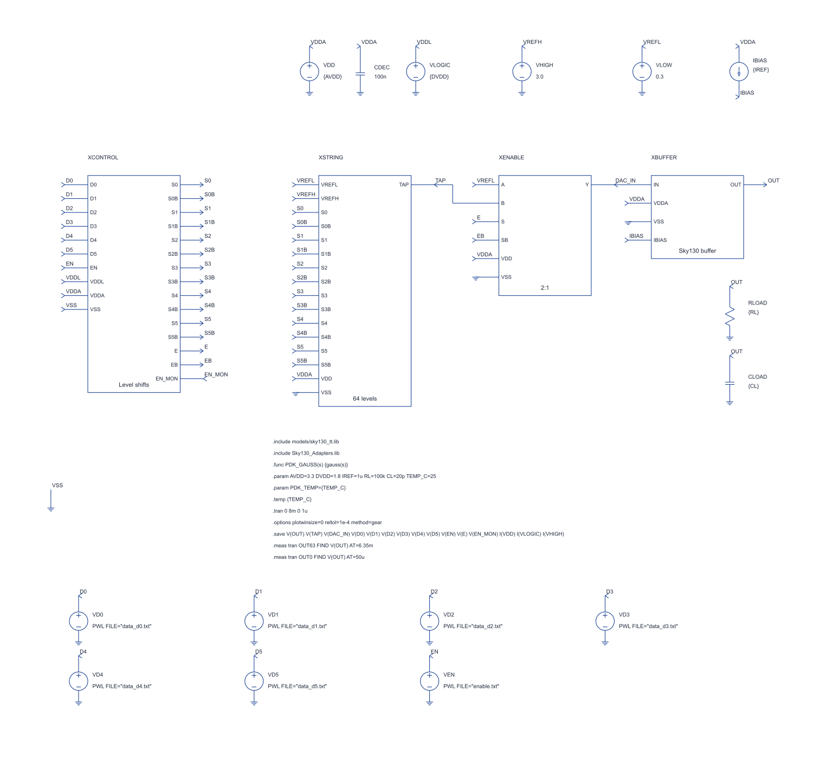
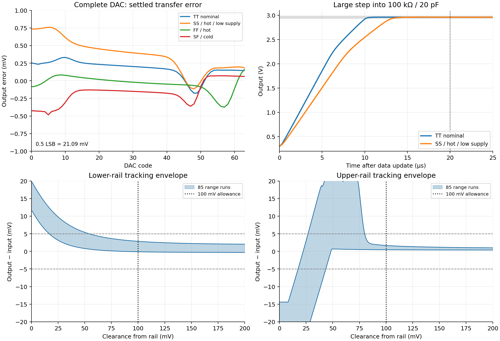
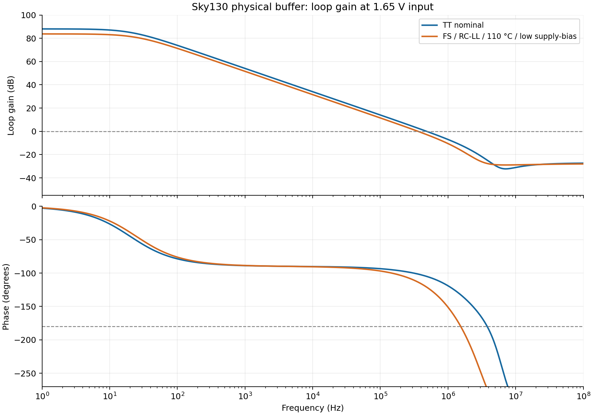

# Sky130 buffered 6-bit DAC: design and verification

This revision replaces the teaching-model circuit with a **pre-layout Sky130 transistor implementation**. The output amplifier, analogue switches, level shifters, digital inverters, resistor string and compensation components use actual foundry models. The main hierarchical LTspice sheet and its child sheets were netlisted and simulated in LTspice.

The present recommendation is to **retain VREFL = 0.300 V and VREFH = 3.000 V**. A provisional **100 mV DC rail-clearance allowance** is supported by the loaded range tests. At minimum VDDA, the highest DAC code has approximately **177 mV** of upper-rail clearance. The 100 mV allowance is a design guard for tracking; the complete performance claim remains limited to the specified references and tested loads.

## 1. What changed

| Circuit item | Implementation |
|---|---|
| Analogue MOS devices | `nfet_g5v0d10v5` / `pfet_g5v0d10v5`, suitable for the 3.3 V domain |
| Low-voltage inverters and EN monitor | `nfet_01v8` / `pfet_01v8`, on VDDD |
| 64 resistor-string units | Four parallel `res_high_po_0p69` devices per unit; W = 0.69 µm, L = 7.33 µm per branch |
| Output amplifier | Original complementary-input, two-stage amplifier: 23 MOS instance groups |
| Compensation resistor | `res_high_po_0p69`, L = 2.2 µm, approximately 1.5 kΩ |
| Compensation capacitor | `cap_mim_m3_1`, W = L = 173 µm, approximately 59.97 pF |
| Feedback | Direct unity-gain connection |

The MOS wrappers use explicit body ties and diffusion geometry. `mult` represents parallel unit devices, including the foundry mismatch scaling. A bank of 100 W=7 µm devices is kept as that bank, rather than being modeled as one W=700 µm device.

The remaining ideal sources and load elements are **external test fixtures**: supplies, reference sources, harness bias, digital patterns, board decoupling and output load. They are not proposed on-chip voltage references or an ideal amplifier hidden inside the circuit.

The model revision is pinned to [SkyWater primitive-library commit 29b5515](https://github.com/fossi-foundation/skywater-pdk-libs-sky130_fd_pr/tree/29b55153fd9f4badef05a02667184b81789d1f61). The foundry coefficients and geometry-bin boundaries are retained. [NOTICE.md](../NOTICE.md) describes the syntax/unit conversions, licensing and source hashes. The five base libraries regenerate byte-for-byte.

## 2. How the stages work

**Control and level shifting.** Each of the six data bits and EN enters a low-voltage inverter and a cross-coupled high-voltage level shifter. These produce true/complement controls swinging to VDDA for the transmission gates. A separate pair of physical 1.8 V inverters produces EN_MON as an internal simulation inspection node. It consumes no harness status output and is not a ready signal. Settling is established by the specified wait after a code or enable change.

**String and tap selection.** Eight banks each contain eight equal resistor units and a local 8:1 selector. Another selector chooses the bank. The six binary bits therefore select one of 64 taps. The string contains 64 units, and code 63 selects tap 63 rather than the upper endpoint:

`Videal(k) = 0.300 + k × (3.000 − 0.300)/64`, for k = 0…63.

One LSB is **42.1875 mV**. The ideal highest output is **2.9578125 V**. Four longer resistors in parallel preserve approximately 1 kΩ per unit while providing more matching area than one short resistor. The nominal measured string current is **42.217 µA**. Absolute resistor variation mainly changes this current; relative matching determines linearity.

**Enable/reset selector.** EN high selects the tap. EN low selects VREFL, so the output returns to approximately 0.3 V. The amplifier remains biased while EN is low. Codes can change while EN is high, as exercised by the main sheet; multi-bit transitions can glitch. The additional protocol examples lower EN before updating the data and provide at least 5 µs data setup before asserting EN. This is an optional host sequence, not a requirement of the latest proposal.

**Bias generation.** The harness supplies 1 µA into the diode-connected N reference. N and P mirrors generate the complementary gate biases. Ten-unit tail devices give approximately 10 µA per input pair, and the 100-unit P output source supplies approximately 100 µA. The mirrors' actual currents include finite output resistance and process/temperature effects; they are not ideal current sources.

**Complementary input stages.** The P input pair covers low common-mode voltages and the N pair covers high common-mode voltages. Their mirror chains convey the differential currents to the summing node G2 while allowing the input-pair drains to stay at suitable voltages. Both pairs contribute around the middle of the input range.

At 0.3 V input, the P input-pair source is about 1.712 V and its conducting device has about 0.871 V drain-source voltage, comfortably above its approximately 0.069 V modeled saturation voltage. At the high code, the N pair's source is about 1.682 V, with approximately 0.516 V drain-source voltage and 0.059 V saturation voltage. The complementary pair supplies the common-mode coverage at each end.

Input fingers and long-channel mirrors provide matching area. The P-path source mirror uses a **30:32 = 15:16** ratio to compensate the systematic current error arising from unequal mirror drain voltages. This is an integer device ratio implemented with foundry transistors. Its effectiveness is checked across corners and mismatch samples.

**Output stage and compensation.** An N common-source transistor drives the output against the mirrored P current source. Two signal inversions give positive forward gain from INP to OUT; connecting OUT to INM closes negative feedback. The physical MIM capacitor and series poly resistor stabilize the amplifier and its mirror poles. The rectangular feedback loop is visible in `DAC_Buffer.asc`.

## 3. Hand calculations and sizing rationale

### Resolution, loading and bias

The full code excursion is `63 × 42.1875 mV = 2.6578125 V`. At code 63, a 100 kΩ load requires:

`Iload = 2.9578125/100000 = 29.578 µA`.

Choosing approximately 100 µA output-source current gives over three times this DC load requirement. A 1 µA reference and a 100:1 P mirror implement that choice. The N output transistor absorbs the remaining current; at nominal high code its modeled current is about 68.7 µA against approximately 98.3 µA from the P source.

A 20 µs full-scale settling limit requires an average slew rate above **0.133 V/µs**. During a large differential error both input pairs can steer current into the summing node. With two nominal 10 µA tails and 59.97 pF compensation:

`SR ≈ (10 + 10) µA / 59.97 pF = 0.333 V/µs`.

This predicts about **8.0 µs** for the large-signal part of a full excursion. At 0.8 µA external bias and the largest modeled compensation capacitance, the corresponding first-order estimate is about **11.1 µs**. Small-signal recovery and mirror dynamics add to that time; the simulations measure the complete settling interval.

### Gain and bandwidth

The input devices operate in moderate/weak inversion, so a simple strong-inversion square-law model is a poor sizing guide here. The following hand calculation uses the actual PDK operating-point derivatives, then predicts the complete amplifier response.

At TT, 25 °C, 3.3 V, 1 µA bias and 1.65 V input:

| Quantity | PDK operating-point value |
|---|---:|
| N input transconductance | 100.18 µS |
| P input transconductance | 91.95 µS |
| Combined approximate input transconductance | 192.13 µS |
| Resistance at G2, from the four mirror output conductances | 1.950 MΩ |
| N output transconductance | 1.047 mS |
| N/P output conductances | 3.50 / 2.16 µS |
| Load conductance | 10.00 µS |

Thus `A1 ≈ 192.13 µS × 1.950 MΩ = 375`, and

`A2 ≈ 1.047 mS / (3.50 + 2.16 + 10.00) µS = 66.9`.

The resulting `A0 ≈ 25,100`, or **88.0 dB**, agrees with approximately **88.03 dB** from LTspice. The first-order unity-frequency estimate is:

`fu ≈ gm1/(2πCc) ≈ 0.510 MHz`.

LTspice gives **0.483 MHz**. The approximate nulling resistance is `1/gm2 ≈ 955 Ω`. The approximately 1.5 kΩ series resistor moves the uncompensated right-half-plane zero toward a left-half-plane zero, around 4.9 MHz in this nominal first-order calculation. Actual mirror/output poles are included in the AC simulations. Nominal phase margin is **75.03°**.

### Rail clearance

At nominal low output, NOUT has approximately **0.300 V VDS** against **0.131 V VDSAT**, giving about **169 mV** nominal saturation reserve. At the high code and minimum supply:

`VDDAmin − Vout,max = 3.135 − 2.9578125 = 177.188 mV`.

The nominal P output-device saturation voltage is approximately **164 mV**. This leaves only about 13 mV of nominal saturation reserve at minimum supply. Process, bias and temperature can move the P device into its linear region. Saturation of every output device is therefore not the acceptance criterion: output error, drive, settling and stability must be tested.

A rough P-device estimate explains the measured closer approach to the rail. Using an effective overdrive `2Id/gm ≈ 0.188 V`, only about 30 µA of its approximately 100 µA capacity is needed by the load. The first-order triode equation predicts about **30 mV** drain-source voltage to supply that load when the N pull-down current approaches zero. The complete buffer needs additional clearance for gain, offset and recovery after clipping. The range tests determine a continuous valid interval, including this recovery; the first point that momentarily crosses the error band is insufficient.

## 4. Measured results

### Complete DAC, simulated from the LTspice sheets

Errors include offset; endpoint INL removes the measured endpoint line. Settling is measured to the ideal output ±0.5 LSB, including the static error.

| Case | Maximum error, mV | DNL, LSB | Endpoint INL, LSB | Worst settling, µs |
|---|---:|---:|---:|---:|
| TT nominal | 0.331 | 0.00233 | 0.00822 | 10.23 |
| SS low supply / hot | 0.759 | 0.00211 | 0.01021 | 13.47 |
| FF hot | 0.375 | 0.00303 | 0.01226 | 7.92 |
| SF cold | 0.484 | 0.00325 | 0.00709 | 12.66 |

The dedicated protocol tests measure settling from EN rising, with data already stable. Their largest enable/reset times are **13.51 / 12.07 µs**. The 20 µs limits pass. The nominal 10 µs design aim is approached rather than exactly met.

Across the four code sweeps, the largest static analogue-supply current is **176.54 µA**, excluding reference-source current. Switching peaks reach approximately **2.66 mA** in these ideal-supply fixtures; the proposal's 1 mA limit is specified for static codes. The supplied board decoupling is external. Final supply routing and harness impedance must be checked with these transients.

The largest static digital-supply current in those sweeps is **2.416 µA**, below the 50 µA target. The largest high-reference current is **43.279 µA**, below 60 µA. These values cover the listed complete-DAC cases; they are not an exhaustive combined MOS/passive-corner current guarantee.

`DAC6_Sky130_Integration.asc` runs the same stimulus through the reusable `DAC6_Sky130_Core.asc` hierarchy. Its 64 settled output samples agree with the architecture sheet within **0.000 µV**, and its accuracy and settling checks pass. The core exposes the latest proposal's VTAP port and has no external EN_MON port.

`DAC6_Sky130_Tap_Probe.asc` adds an external **10 MΩ / 10 pF** measurement load to VTAP. Its maximum absolute output error is **3.258 mV (0.0772 LSB)** and its largest measured settling time is **10.23 µs**. Both remain within the proposal limits. The 10 pF is a provisional probe/shared-line capacitance; the actual harness value must be supplied later.

For scale, the string's maximum Thevenin resistance is approximately `64 kΩ / 4 = 16 kΩ`, before switch resistance. At mid-code the 10 MΩ meter therefore pulls a 1.65 V tap down by about `1.65 × 16k/(10M + 16k) = 2.64 mV`. Loading peaks above mid-code, and switch resistance adds to it. A 10 MΩ meter is adequate for the 6-bit limit, but its loading must be accounted for when characterising the much smaller intrinsic string INL. A higher-impedance active probe is preferable for that measurement.

The 1 kΩ overload produces approximately **0.1055 V** at code 63. That is the expected failure: the load requests milliamps while the class-A source supplies roughly 100 µA.

### Loaded range and recommended margin

The **85 range runs** cover five MOS corners, −40/25/110 °C, 3.135/3.3/3.465 V and selected 0.8/1.2 µA bias extremes. Each uses a slow excursion to both rails into 100 kΩ / 20 pF. Inside a 100 mV clearance from each rail, the measured tracking-error envelope is **-2.169 to 2.842 mV**.

With a ±5 mV tracking criterion, the most restrictive observed lower boundary is approximately **54.5 mV above ground**; the largest required upper clearance is approximately **80.1 mV**. These are sampled slow-ramp boundaries, not absolute maximum ratings or a guaranteed extended DAC specification.

A **100 mV loaded-tracking allowance** covers those observed continuous-range boundaries. This includes recovery after the rail excursion and provides a provisional design guard. The selected DAC references provide about **300 mV lower clearance** and **177 mV upper clearance at minimum supply**. Consequently there is approximately **200 mV / 77 mV** beyond that allowance. A mandatory 300 mV upper clearance would unnecessarily restrict this implementation at minimum supply.

### Stability and passive corners

**All 540 LTspice AC points pass the 60° phase-margin target.** The lowest margin is **66.51°**, at FS / low-R-low-C, 110 °C, VDDA 3.135 V, 0.8 µA bias, 1.65 V input and 20 pF load. The smallest measured open-loop gain is **62.50 dB**, and the lowest unity frequency is **128.8 kHz** in the tested combinations.

Loop gain is `−V(out)/V(fb)` with an AC source inserted in the unity-feedback path. The source is zero volts at DC. The matrix checks the three input levels **0.300, 1.650 and 2.9578125 V**, both 0/20 pF capacitive loads, supply/bias endpoints and all three temperatures. The additional RC matrix crosses the four official high/low passive combinations with all MOS corners and temperatures at low supply/bias.

The selected model-card subsets retain the original coefficients and inclusive bin-boundary candidates. Full-library and subset traces were identical in the tested low/high-input comparison. The alternate LTspice solver is used for these matrices; some endpoint operating points converge slowly with the regular solver. The ngspice AC screen additionally checks its actual DC bias and compensation-resistor DC drop before accepting a result.

The **60 large-step RC-corner runs** give a largest settling time of **16.40 µs**, below 20 µs.

### Mismatch

The nominal-condition screens enable the foundry's local mismatch expressions and use 100 seeds for each block. Each run sets the seed and resets the circuit before simulation, so parameter-level random draws are reproducible. Amplifier codes have 100 µs dwell and are sampled after 80 µs, matching the complete-DAC static measurements:

| Screen | Largest observed result |
|---|---:|
| Amplifier absolute tracking error over the 64 requested levels | 0.0700 LSB |
| Amplifier zero-code error magnitude | 0.0614 LSB |
| Amplifier span-error magnitude | 0.0967 LSB |
| Resistor string DNL magnitude | 0.0254 LSB |
| Resistor string endpoint INL magnitude | 0.0732 LSB |

All 100 nominal samples meet the listed block allocations. The span result is close to its 0.1 LSB allocation, so input/mirror matching remains a priority for layout and joint PVT qualification.

These are separate amplifier and string screens. They do not constitute a combined full-chip Monte Carlo yield result, and do not include layout gradients or extracted routing. The committed reference JSON contains the individual samples.

## 5. Chipalooza fit and remaining qualification

The reusable core follows the latest [v2 proposal](https://github.com/AlexZGray/Chipalooza/blob/main/docs/proposal/v2/Chipalooza_DAC6_Proposal.md): **seven digital control inputs, zero harness status outputs, three shared analogue lines (VREFH/VREFL/VTAP), one requested dedicated pad (VOUT), and one 1 µA harness bias current**. This is within the slide's stated resource counts, subject to approval of the dedicated pad. It uses separate 1.8 V and 3.3 V domains and does not consume a shared bandgap voltage. [interface.json](../interface.json) records the allocation. EN_MON remains internal. The simulation labels TAP and OUT correspond to core pins VTAP and VOUT.

The proposal's operating temperature range is −20 to 110 °C; the simulations include a colder −40 °C endpoint as an additional stress case. The reference sources are connected at the block pins. **The proposal's estimated 0.2 mV shared-reference-switch drop is not verified here**: the organiser's harness-switch model was unavailable. Its resistance, loading, reference sink capability and test-line capacitance must be included before claiming complete harness accuracy. VREFL must sink approximately the string current. Limits are referred to the actual reference voltages at the block.

The MIM plate is approximately **173 × 173 µm**, or **0.030 mm²**. The sum of MOS gate areas is approximately 0.0265 mm², and resistor bodies/end regions add roughly 0.0020 mm². This approximately 0.059 mm² feature-area sum is **not a layout-area estimate**: wells, contacts, dummies, guard rings and routing add area. Slot fit must be checked against the allocated wrapper.

Before calling this a final silicon design, complete the layout and DRC/LVS, replace diffusion estimates with extraction, include pad/ESD and harness models, test power sequencing and reference/bias noise, verify load regulation and digital input limits, and run combined mismatch/PVT qualification. The reference sources and supply rails are ideal fixtures here. The present simulations establish feasibility and a defensible provisional buffer margin for the specified references; they do not replace those tapeout checks.

## 6. Reproduction and evidence

Use [the setup guide](../README.md) to run the sheets and numerical checkers. `results/reference_ltspice.json` records the complete DAC measurements, `reference_validation.json` the range/mismatch cross-checks, and `reference_lt_ac.json` the LTspice stability matrix. The model license, source hashes, regeneration tools and all required schematic/symbol files are included.

Device voltage domains and passive-model definitions can be checked against the [official Sky130 device documentation](https://skywater-pdk.readthedocs.io/en/main/rules/device-details.html) and the pinned source linked above. Model validity is distinct from final pad and reliability qualification.
